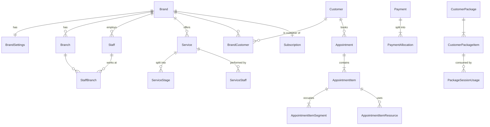

# Alan modeli

Bu belge OMVILA'nın varlıklarını, ilişkilerini ve değişmezlerini (invariant) tanımlar. Kod, veritabanı ve `contracts/openapi.yaml` bu belgeyle uyumlu olmak zorundadır. Bir alan eklemek veya anlamını değiştirmek için önce bu belge güncellenir (bkz. `docs/standartlar/tanim-bitti.md`).

İlgili belgeler:
- Durumlar ve geçişler: [durum-makinesi.md](durum-makinesi.md)
- Ayarlar, süreler, varsayılanlar: [sureler-ve-ayarlar.md](sureler-ve-ayarlar.md)
- Roller ve yetkiler: [roller-yetkiler.md](roller-yetkiler.md)
- Müsaitlik hesabı ve çakışma: [musaitlik.md](musaitlik.md)
- Ekran adı ↔ kod adı: [sozluk.md](sozluk.md)

## Kaynak ve öncelik

Bu model eski backend'in şemasından (`docs/referans/eski-veritabani-semasi.md`, 64 tablo) ve kurallarından (`docs/referans/eski-teknik-kurallar.md`) türetildi. Sonra Kasım 2026 kararlarıyla ve tasarım ekranlarıyla düzeltildi. Çelişkide öncelik sırası şöyledir:

1. `docs/urun/KARAR-GUNLUGU.md` ve `docs/urun/teslim-notlari.md`
2. Tasarım ekranları (`design/ekranlar/`)
3. Bu belge
4. Eski referans belgeler (yalnız iş kuralı ve alan adı fikri için; teknik tercihleri bağlayıcı değil)

Eski şemadan **bilerek ayrılan** noktalar bölüm sonundaki "Eski şemadan farklar" tablosundadır.

## Ortak kurallar (her varlık için)

| Konu | Kural |
|---|---|
| Kimlik | `Id: uuid`, uygulamada UUID v7 (`Guid.CreateVersion7()`) ile üretilir; zamana göre sıralıdır. |
| Kiracı | Markaya ait her tabloda `BrandId` vardır (başka tablodan türetilebilse bile). Bkz. ADR-0006. |
| Zaman damgası | Anlık zaman `Instant` → PostgreSQL `timestamptz`, adı `...Utc` ile biter (`StartUtc`, `CreatedUtc`). |
| Yerel takvim | Çalışma saatleri ve özel günler yerel saattir: `LocalTime` → `time`, `LocalDate` → `date`. Saat dilimi şubededir (`Branch.TimeZoneId`, varsayılan `Europe/Istanbul`). |
| Para | Kuruş cinsinden tamsayı: `...Minor: long` → `bigint`; yanında `CurrencyCode` (`TRY`). `decimal`/`money` para için kullanılmaz. Yüzde `decimal(5,2)`. |
| Denetim alanları | `CreatedUtc`, `CreatedByUserId?`, `UpdatedUtc?`, `UpdatedByUserId?`. Tabloda yazılmadıkça bu belgede tekrar edilmez. |
| Eşzamanlılık | Düzenlenebilir varlıklarda iyimser kilit: PostgreSQL `xmin` sütunu EF'de `IsRowVersion()` olarak eşlenir; API'de `ETag` / `If-Match`. |
| Silme | Fiziksel silme yoktur. `IsActive` veya `Status` kullanılır. Tek istisna KVKK anonimleştirmesidir (`Customer.AnonymizedUtc`). |
| Telefon | E.164 biçiminde saklanır (`+905321234567`). Tek bir `PhoneNumber` değer nesnesi normalleştirir; "0532 123 45 67", "5321234567", "+90 532 123 4567" aynı numaradır. |
| Enum | Veritabanında metin (`varchar` + CHECK) olarak saklanır, sayı olarak değil. API'de PascalCase metin. |

## Modüller

Backend modüler monolittir. Her modül kendi PostgreSQL şemasına (schema) sahiptir. Modüller birbirinin tablolarına doğrudan erişmez; yalnız diğer modülün `Contracts` projesindeki arayüzler ve olaylar üzerinden konuşur (bkz. `docs/mimari/mimari.md`).

| Modül | DB şeması | Sahip olduğu varlıklar |
|---|---|---|
| Identity | `identity` | User, Role, Permission, RolePermission, UserMembership, TermsAcceptance, OtpChallenge, RefreshToken, CustomerSession, TrustedDevice |
| Tenancy | `tenancy` | Brand, BrandSettings, Branch, BranchWorkingHours, WorkingHoursOverride, PublicHoliday, BranchTransferTime, Staff, StaffBranch, StaffWorkingHours, TimeOff, BrandBankAccount, BookingPageSettings |
| Catalog | `catalog` | Industry, ServiceTemplate, ServiceCategory, Service, ServiceStage, ServiceStaff, BranchServicePrice, ResourceType, Resource, ResourceDowntime, ServiceResourceRule, Package, PackageItem |
| Customers | `customers` | Customer, BrandCustomer, Tag, BrandCustomerTag, ConsentRecord, CustomerSavedBrand, DataDeletionRequest, CustomerImport |
| Scheduling | `scheduling` | Appointment, AppointmentItem, AppointmentItemSegment, AppointmentItemResource, AppointmentSeries, AppointmentAccessCode, WaitlistEntry, WaitlistOffer, WalkInTicket, BranchQueueCounter |
| Sales | `sales` | Payment, PaymentAllocation, CustomerPackage, CustomerPackageItem, PackageSessionUsage, CommissionEntry, CashDayClose |
| Reviews | `reviews` | Review |
| Notifications | `notifications` | NotificationOutbox, InAppNotification, NotificationTemplate, BrandSmsSender, CreditTransaction, NotificationPreference, Device |
| Integrations | `integrations` | CalendarLink, AppointmentCalendarSync |
| Platform | `platform` | Plan, CreditPackage, Subscription, SubscriptionInvoice, PaymentNotice, PlatformBankTransaction, AuditLog |

Ortak altyapı tabloları (modül değil): `infra.job_runs` (zamanlanmış iş kayıtları), `infra.idempotency_keys`, `infra.outbox_events` (modüller arası olaylar).

---

## Identity

Üç tür oturum vardır ve birbirine karışmaz: **salon kullanıcısı** (`User` + markadaki rolleri), **platform kullanıcısı** (`User.PlatformRole` dolu) ve **müşteri** (`Customer`, User değildir). Her birinin JWT'si ayrı `aud` (audience) taşır: `manage`, `admin`, `me`. Rezervasyon sayfasının kısa ömürlü doğrulama jetonu `public-booking` audience'ıdır.

### User
Salon çalışanı veya OMVILA ekibi. Giriş yalnız telefon + SMS koduyla yapılır; şifre yoktur.

| Alan | Tip | Not |
|---|---|---|
| PhoneE164 | string | UNIQUE |
| FullName | string(120) | |
| Email | string(160)? | |
| LanguageCode | string(5) | `tr` |
| PlatformRole | enum? | `PlatformAdmin`, `PlatformSupport`, `PlatformFinance`; doluysa platform kullanıcısıdır ve marka üyeliği olamaz |
| IsActive | bool | |
| LastLoginUtc | Instant? | |

### Role, Permission, RolePermission
- `Role`: sistem rolleri `Owner`, `BranchManager`, `Staff` (`IsSystem = true`, `BrandId = null`). v1'de markaya özel rol yoktur.
- `Permission`: `Code` (ör. `appointment.approve`), `Category`. Tam liste ve matris: [roller-yetkiler.md](roller-yetkiler.md).

### UserMembership
Kullanıcının bir markadaki rolü. (Eski adı `UserRole`.)

| Alan | Tip | Not |
|---|---|---|
| UserId, BrandId, RoleId | uuid | |
| BranchIds | uuid[] | Boş = tüm şubeler (Owner her zaman boş). BranchManager ve Staff için şube kapsamı (bir veya birden çok şube; sözleşme `membership.branchIds`) |
| StaffId | uuid? | Bağlı personel kaydı (jeton iddiası `staff_id`) |
| Status | enum | `Invited`, `Active`, `Disabled` ("Davet gönderildi" rozeti) |

Değişmezler: bir kullanıcının bir markada en fazla bir `Owner` üyeliği vardır. Her markada en az bir aktif `Owner` bulunur. v1'de bir kullanıcı yalnız bir markaya üye olabilir (çoklu marka hesabı v2).

### OtpChallenge
SMS doğrulama kodu. (Eski adı `OtpCode`.)

| Alan | Tip | Not |
|---|---|---|
| PhoneE164 | string | |
| Purpose | enum | `ManageLogin`, `ManageSignup`, `CustomerLogin`, `PublicBooking`, `AccountDeletion` |
| CodeHash | string | Kod düz metin saklanmaz (HMAC-SHA256) |
| ExpiresUtc | Instant | |
| AttemptCount | int | Sınır aşılınca kilitlenir (bkz. süreler) |
| ConsumedUtc | Instant? | Tek kullanımlık |

### RefreshToken / CustomerSession
Yenileme jetonu; yalnız hash'i saklanır. Her kullanımda döndürülür (rotation). Eski jeton yeniden kullanılırsa o zincirdeki tüm jetonlar iptal edilir. `RefreshToken.UserId` salon/platform içindir, `CustomerSession.CustomerId` müşteri içindir. Ortak alanlar: `TokenHash` (UNIQUE), `FamilyId`, `ExpiresUtc`, `RevokedUtc?`, `DeviceLabel?`, `RememberDevice: bool` (panelde "Bu bilgisayarda 30 gün hatırla").

### TermsAcceptance
Salon kullanıcısının kullanım koşulları ve aydınlatma metni onayı: `UserId`, `DocumentType` (`TermsOfUse`, `PrivacyNotice`), `DocumentVersion`, `AcceptedUtc`, `IpAddress?`. Kayıtta zorunludur; yeni sürüm yayınlanınca girişte yeniden istenir.

### TrustedDevice
Rezervasyon sayfasında bir telefon bir kez doğrulandıktan sonra aynı tarayıcıdan tekrar randevuda kod istenmez. Alanlar: `PhoneE164`, `TokenHash` (çerezde saklanan rastgele değerin hash'i), `ExpiresUtc`, `LastUsedUtc`.

### Device
Push bildirimi için cihaz kaydı. Hem müşteri hem işletme uygulaması kullanır. Notifications modülündedir (gönderim işi cihazları okur; T-66). İşletme cihazı kaydedildiği markanın kiracı bağlamındadır (`BrandId`, RLS); ayrıca `AppVersion`, `CreatedUtc`.

| Alan | Tip | Not |
|---|---|---|
| OwnerType | enum | `Customer`, `User` |
| OwnerId | uuid | |
| App | enum | `Customer`, `Business` |
| Platform | enum | `iOS`, `Android` |
| PushToken | string | Aktif kayıtlar arasında UNIQUE |
| IsActive | bool | Sağlayıcı "geçersiz jeton" derse `false` |
| LastSeenUtc | Instant | |

---

## Tenancy

### Brand (Marka)
Kiracı (tenant). Platform panelinde "Marka", salon tarafında "İşletme" diye görünür.

| Alan | Tip | Not |
|---|---|---|
| Name | string(160) | "Kuaför Elif" |
| Slug | string(120) | UNIQUE; rezervasyon adresi `omvila.com/{slug}` |
| IndustryId | uuid | Kayıt ekranındaki "Ne tür bir işletme?" |
| Status | enum | `Onboarding`, `Active`, `Suspended`, `Archived` |
| ShortDescription | string(160)? | Rezervasyon sayfasında görünür |
| About | string(2000)? | |
| LogoUrl | string? | En az 400×400 |
| Phone, Email, Instagram, Website | string? | İletişim |
| LegalName, TaxOffice, TaxNumber | string? | OMVILA'nın keseceği abonelik faturası için |
| DefaultCurrencyCode | char(3) | `TRY` |

Değişmez: `Slug` küçük harf, `[a-z0-9-]`, 3–60 karakter. Değiştirilirse eski bağlantı 30 gün yönlendirilir (`BrandSlugHistory`, Tenancy içinde küçük tablo).

### BrandSettings
Markanın davranış ayarları. Her alanın anlamı, varsayılanı ve ekrandaki yeri: [sureler-ve-ayarlar.md](sureler-ve-ayarlar.md). Ayarlar tek satırdır (`BrandId` PK) ve `xmin` ile korunur.

### BookingPageSettings
Rezervasyon sayfası görünümü ("Ayarlar → Rezervasyon sayfası"): `CoverColorToken` (`petrol`/`mercan`/`kum`), `ShowReviews`, `ShowPrices`, `PreAppointmentNote` (onay ekranında ve onay SMS'i altında gösterilir).

### BrandBankAccount
Kaporanın gönderileceği salon hesabı ("Ayarlar → Kapora ve IBAN"). **OMVILA bu hesaba para göndermez veya hesaptan para çekmez; yalnız müşteriye gösterir.**

| Alan | Tip | Not |
|---|---|---|
| AccountHolderName | string(120) | Müşterinin bankasında görünecek ad; salon sahibi veya şirket |
| BankName | string(80) | |
| IbanEncrypted | bytes | Uygulama düzeyinde şifreli (bkz. güvenlik) |
| IbanLast4 | string(4) | Listelerde maskeli gösterim için |
| TransferCodePrefix | string(5) | Varsayılan `OMV` |
| TransferWindowMinutes | int | 60 / 120 / 240; varsayılan 120 |
| IsActive | bool | |

Değişmez: aktif `BrandBankAccount` yoksa hiçbir hizmete kapora konamaz ve kapora politikası `None` olarak davranır ("Kapora alınamaz" durum deseni).

### Branch (Şube)

| Alan | Tip | Not |
|---|---|---|
| Name | string(120) | "Kadıköy" |
| Slug | string(120) | Marka içinde UNIQUE |
| AddressLine, District, City, PostalCode, CountryCode | string | |
| Latitude, Longitude | decimal(9,6)? | "Yol tarifi" |
| Phone, Email | string? | "Salonu ara" |
| TimeZoneId | string | IANA; varsayılan `Europe/Istanbul` |
| SlotIntervalMinutes | int? | `null` → `BrandSettings.SlotIntervalMinutes` |
| IsActive | bool | |

### BranchWorkingHours
Şubenin haftalık saatleri; günde birden çok aralık olabilir (öğle arası).
Alanlar: `BranchId`, `DayOfWeek` (ISO 1=Pazartesi … 7=Pazar), `StartTime`, `EndTime` (yerel), `EffectiveFrom?`, `EffectiveTo?`.
Değişmez: aynı gün içindeki aralıklar örtüşmez; `StartTime < EndTime` (gece yarısını aşan aralık v1'de yok).

### WorkingHoursOverride (Özel gün)
Belirli bir tarih için şube **veya** personel saatini ezer: kapalı gün, kısa gün, "Yalnızca bu gün için aç".
Alanlar: `Date`, `BranchId?` XOR `StaffBranchId?`, `IsClosed`, `StartTime?`, `EndTime?`, `Note?`, `Kind` (`Holiday`, `Closure`, `ExtraOpening`, `ShortDay`).
Ekranda "Kapalı günler" listesi: "Her pazar · Haftalık" haftalık saatlerden, "1 Ocak · Tek gün" ve "Ramazan Bayramı · 3 gün" bu tablodan gelir.

### PublicHoliday
Ülke tatilleri (`CountryCode`, `Date`, `IsHalfDay`, `Name`). Platform yönetir. Şube "Resmi tatil · kapalı" önerisini kabul ederse `WorkingHoursOverride` üretilir; tatil kendiliğinden kapatmaz.

### BranchTransferTime
Personelin iki şube arasında geçiş süresi (`FromBranchId`, `ToBranchId`, `Minutes`). Tanımlı değilse `BrandSettings.DefaultBranchTransferMinutes` (30) kullanılır.

### Staff (Personel)

| Alan | Tip | Not |
|---|---|---|
| UserId | uuid? | Uygulamaya giriş yapacaksa; UNIQUE |
| FullName | string(120) | |
| DisplayName | string(120)? | Rezervasyon sayfasında görünen ad |
| Title | string(60)? | "Renk uzmanı", "Kurucu · kuaför" |
| Bio | string(1000)? | |
| PhotoUrl | string? | |
| CalendarColor | string(7) | Tasarımdaki 7 renkten biri; yalnız takvim başlığındaki avatar halkasında kullanılır |
| ServiceCommissionPercent | decimal(5,2) | "Hizmet primi" |
| SaleCommissionPercent | decimal(5,2) | "Paket satış primi" |
| IsBookableOnline | bool | "Online randevuya açık" |
| EmploymentStartOn, EmploymentEndOn | LocalDate? | |
| IsActive | bool | |

### StaffBranch
Personelin çalıştığı şubeler (`StaffId`, `BranchId`, `IsPrimary`, `IsActive`). UNIQUE (`StaffId`, `BranchId`).

### StaffWorkingHours
Personelin bir şubedeki haftalık saatleri (`StaffBranchId`, `DayOfWeek`, `StartTime`, `EndTime`, `EffectiveFrom?`, `EffectiveTo?`). "Mola 13:00–13:45" ayrı aralık olarak değil, iki çalışma aralığı olarak saklanır (10:00–13:00, 13:45–19:00). Arayüz molayı ikisinin arasından türetir.
Değişmez: bir personelin farklı şubelerdeki aralıkları aynı anda örtüşemez.

### TimeOff (İzin)
`StaffId`, `StartUtc`, `EndUtc`, `Type` (`Leave`, `Break`, `Training`, `Sick`, `Other`), `IsAllDay`, `Note?`.
İzin tüm şubelerde geçerlidir. Var olan randevuların üstüne izin eklenebilir; arayüz etkilenen randevu sayısını gösterir ("Bu tarihlerde Elif'in 5 randevusu var") ve izni kaydettikten sonra o randevulara yönlendirir. İzin randevuları otomatik iptal **etmez**.

---

## Catalog

### Industry, ServiceTemplate
`Industry` platformun sektör listesidir (`Code`: `barber`, `hair_salon`, `beauty`, `spa`, `nail`, `dietitian`, `other`). `ServiceTemplate` sektöre göre hazır hizmet listesidir ("Hizmetler sektör hazır listesiyle başlamayı önerir"). Şablondan hizmet kopyalanır; kopyadan sonra bağı yoktur.

### ServiceCategory
Rezervasyon sayfasındaki sekmeler ve panel listesindeki gruplar (Saç, Renk, Bakım, Tırnak). Alanlar: `Name`, `SortOrder`, `IsActive`. Marka içinde ad UNIQUE.

### Service (Hizmet)

| Alan | Tip | Not |
|---|---|---|
| CategoryId | uuid | |
| Name | string(120) | Marka içinde aktifler arasında UNIQUE |
| Description | string(1000)? | "Uzunluğa göre değişir, prova dahil" |
| DurationMinutes | int | Aşamalar varsa aşama sürelerinin toplamı (türetilmiş, saklanır) |
| BasePriceMinor | long | |
| PriceDisplay | enum | `Fixed` ("450 ₺"), `StartingFrom` ("1.800 ₺'den") |
| BufferBeforeMinutes, BufferAfterMinutes | int | "Tampon süre"; personel meşgul sayılır |
| DepositMode | enum | `Inherit` (marka politikası), `Always`, `Never` |
| DepositAmountMinor | long? | `DepositPercent` ile XOR |
| DepositPercent | decimal(5,2)? | |
| RequiresApproval | bool? | `null` = marka ayarı |
| IsOnlineBookable | bool | "Online randevuya açık" |
| MinNoticeMinutes | int? | `null` = marka ayarı |
| MaxAdvanceDays | int? | `null` = marka ayarı |
| MinDaysBetweenSessions | int? | Paketli seanslar için |
| SortOrder | int | |
| IsActive | bool | |

Değişmezler: `DepositMode = Always` ise tutar veya yüzde dolu olmalıdır. Kapora tutarı hizmet fiyatını aşamaz. Fiyatı `StartingFrom` olan hizmette yüzde kapora en düşük fiyattan hesaplanır.

Geçmiş: hizmet, fiyat ve paket değişiklikleri randevuya fiyat kopyalandığı için geçmişi bozmaz. Ayrıca "kim neyi ne zaman değiştirdi" `AuditLog`'a yazılır. Eski şemadaki temporal tablolar yoktur.

### ServiceStage (Aşama)
Bekleme dilimli hizmetler için ("Uygulama 45 dk · Bekleme 40 dk · Yıkama ve fön 35 dk").
Alanlar: `ServiceId`, `SeqNo`, `Name`, `DurationMinutes`, `StaffBusy` (bekleme aşamasında `false`).
Aşaması olmayan hizmet tek örtük aşamalıdır (`StaffBusy = true`, süre = `DurationMinutes`).

### ServiceStaff
Hizmeti kim veriyor ("Kimler veriyor?") ve personele özel fark: `ServiceId`, `StaffId`, `DurationOverrideMinutes?` ("75 dk (özel)"), `SurchargeMinor` ("+200 ₺"), `CommissionPercentOverride?`, `IsActive`.
Değişmez: hizmeti veren aktif personel yoksa hizmet online seçilemez.

### BranchServicePrice
Şubeye özel fiyat veya süre ("Fiyatlar Kadıköy şubesi için. Nişantaşı'nda farklı fiyat tanımlıysa o şubeyi seçince görünür"): `BranchId`, `ServiceId`, `PriceMinor`, `DurationOverrideMinutes?`, `IsAvailable` (hizmet bu şubede verilmiyorsa `false`).

**Fiyat ve süre çözümü** (randevu oluşurken bir kez hesaplanır ve kaleme kopyalanır):
- Fiyat = `BranchServicePrice.PriceMinor` ?? `Service.BasePriceMinor`, + `ServiceStaff.SurchargeMinor`
- Süre = `ServiceStaff.DurationOverrideMinutes` ?? `BranchServicePrice.DurationOverrideMinutes` ?? `Service.DurationMinutes`. Aşamalı hizmette süre farkı **son personel-meşgul aşamaya** eklenir veya çıkarılır.

### ResourceType, Resource, ResourceDowntime, ServiceResourceRule
Oda ve cihaz ("Oda veya cihaz: Boya odası").
- `ResourceType`: `Name`, `IsExclusive` (aynı anda tek kullanım).
- `Resource`: `BranchId`, `ResourceTypeId`, `Name`, `Capacity` (≥1), `IsActive`.
- `ResourceDowntime`: `ResourceId`, `StartUtc`, `EndUtc`, `Note`.
- `ServiceResourceRule`: hizmet hangi aşamalarda hangi kaynak türünden kaç adet ister (`ServiceId`, `ResourceTypeId`, `Quantity`, `StageSeqFrom?`, `StageSeqTo?`). `null` = tüm aşamalar.

### Package, PackageItem (Paket tanımı)
`Package`: `Name`, `PriceMinor`, `ValidityDays` (geçerlilik), `IsAvailableAllBranches` ("Bütün şubelerde kullanılabilir"), `IsTransferable`, `IsActive`.
`PackageItem`: `PackageId`, `ServiceId`, `SessionCount`.
Paket satış primi personelin `SaleCommissionPercent`'inden gelir. "Paket oluştur" ekranındaki "Satış primi %10" pakete özel bir ezme değeridir: `Package.SaleCommissionPercentOverride?`.

---

## Customers

### Customer (global kişi)
Telefonla tanınan gerçek kişi. Bir markaya ait **değildir**. Markalar bu kaydın tamamını görmez; yalnız kendi `BrandCustomer` kaydını ve randevu için gereken ad/telefonu görür.

| Alan | Tip | Not |
|---|---|---|
| PhoneE164 | string | UNIQUE |
| FullName | string(120) | Müşterinin kendi verdiği ad |
| Email | string(160)? | |
| BirthYear | int? | Yalnız yıl; tam doğum tarihi tutulmaz |
| Gender | enum? | `Female`, `Male`, `Unspecified` |
| LanguageCode | string(5) | |
| IsVerified | bool | En az bir kez OTP ile doğrulandı |
| HasAppAccount | bool | Müşteri uygulamasına giriş yaptı |
| MergedIntoId | uuid? | Birleştirildiyse hedef kayıt |
| AnonymizedUtc | Instant? | KVKK silmesi yapıldıysa |

### BrandCustomer (markanın müşterisi)
Salon panelindeki "Müşteri". Not, etiket ve sayaçlar buradadır; başka marka görmez.

| Alan | Tip | Not |
|---|---|---|
| BrandId, CustomerId | uuid | UNIQUE (BrandId, CustomerId) |
| DisplayName | string(120)? | Salonun kendi yazdığı ad (müşterinin adından farklı olabilir) |
| Notes | string? | Serbest metin; **sağlık bilgisi yazılmaz** (arayüz uyarır) |
| Source | enum | `Online`, `Panel`, `Phone`, `WalkIn`, `Import` ("İlk kanal") |
| PreferredStaffId | uuid? | "Tercih ettiği" |
| FirstVisitOn, LastVisitOn | LocalDate? | Türetilmiş, saklanır |
| VisitCount, CancelCount, NoShowCount | int | Türetilmiş sayaçlar; olaylarla güncellenir |
| TotalSpentMinor | long | Tamamlanan randevulardan |
| IsBlocked | bool | Engellenen müşteri online randevu alamaz |
| BlockReason | string? | |

"Riskli müşteri" bir alan değil, türetilmiş bir durumdur: `NoShowCount >= BrandSettings.RiskyCustomerNoShowThreshold`.
Panel filtreleri ("Düzenli", "Yeni", "Paketi olan", "Gelmeme riski", "60+ gündür gelmeyen") sorgu kurallarıdır; tanımları [sozluk.md](sozluk.md) içindedir.

### Tag, BrandCustomerTag
Markaya özel etiketler ("Düzenli", "Ürün tercihi var"). Sistem etiketleri (Düzenli, Yeni, Paketli, 2 kez gelmedi) saklanmaz, hesaplanır. `Tag` yalnız salonun elle eklediği etiketlerdir.

### ConsentRecord (Rıza kaydı)
Her rıza veya geri çekme bir satırdır; güncellenmez, yeni satır eklenir.

| Alan | Tip | Not |
|---|---|---|
| CustomerId | uuid | |
| BrandId | uuid? | Kampanya izni markaya özeldir; aydınlatma metni okundu bilgisi marka bazlıdır |
| ConsentType | enum | `PrivacyNoticeAcknowledged` (aydınlatma metni okundu), `MarketingSms`, `MarketingEmail`, `MarketingPush` |
| IsGranted | bool | |
| DocumentVersion | string(20) | Aydınlatma metni sürümü |
| Channel | enum | `Web`, `CustomerApp`, `BusinessApp`, `Panel`, `Import` |
| IpAddress | string? | |
| OccurredUtc | Instant | |

Kural: randevu bildirimleri (onay, hatırlatma, değişiklik) işlem mesajıdır, rızaya bağlı değildir ve müşteri tarafından kapatılamaz. Kampanya mesajı göndermeden önce son `Marketing*` kaydı `IsGranted = true` olmalı **ve** İYS kontrolü geçmelidir.
Salon panelden müşteri eklerken kampanya iznini işaretleyemez ("Kampanya mesajı izni müşteriden alınır").

### CustomerSavedBrand
Müşteri uygulamasında QR veya bağlantıyla eklenen salon. `BrandCustomer` **oluşturmaz**; salon, randevu almamış birini müşteri listesinde görmez. Alanlar: `CustomerId`, `BrandId`, `AddedUtc`, `Source` (`Qr`, `Link`, `Booking`).

### DataDeletionRequest (KVKK silme talebi)
`CustomerId`, `BrandId?` (`null` = müşterinin kendi hesabını tümden silmesi), `RequestedVia` (`CustomerApp`, `Panel`), `Status` (`Pending`, `Completed`, `Rejected`), `DueOn` (30 gün), `CompletedUtc?`.
Anonimleştirme kuralı: ad, telefon, e-posta, notlar maskelenir veya silinir. Randevu, ödeme ve prim kayıtları anonim olarak kalır (yasal saklama). Yaklaşan randevular iptal edilir (iptal nedeni `AccountDeleted`). Aktif paket varsa arayüz önce uyarır.

### CustomerImport
CSV içe aktarma işi: `FileName`, `TotalRows`, `ToCreate`, `ToMerge`, `InvalidRows`, `Status` (`Previewed`, `Committed`, `Failed`), `SendInfoSms` (içe aktarılanlara randevu bilgilendirme SMS'leri gönderilsin mi), hata raporu.

### Birleştirme
"Kayıtları birleştir" marka içinde iki `BrandCustomer`'ı birleştirir (randevular, paketler, ödemeler ve isteğe bağlı notlar hedefe taşınır). Kaynak kayıt arşivlenir. İki farklı telefon iki farklı `Customer` ise global kayıtlar birleştirilmez; yalnız markadaki görünüm birleşir (`BrandCustomer.MergedIntoId`). Global `Customer.MergedIntoId` yalnız platform desteğiyle kullanılır.

---

## Scheduling

### Appointment (Randevu, kap)

| Alan | Tip | Not |
|---|---|---|
| BranchId | uuid | |
| CustomerId | uuid | Global `Customer`; marka görünümü `BrandCustomer` üzerinden |
| BrandCustomerId | uuid | Randevu oluşunca yoksa oluşturulur |
| Status | enum | Bkz. [durum-makinesi.md](durum-makinesi.md) |
| Channel | enum | `Online`, `Panel`, `Phone`, `WalkIn` ("Nasıl geldi?") |
| ClientApp | enum? | `BookingPage`, `CustomerApp`, `BusinessApp`, `Panel` (analitik) |
| StartUtc, EndUtc | Instant | Kalemlerden türetilen özet; kalem değişince güncellenir |
| TotalAmountMinor | long | Kalem fiyatları − indirim |
| CurrencyCode | char(3) | |
| CustomerNote | string(500)? | "Salona notunuz" |
| StaffNote | string(1000)? | Yalnız salon görür |
| HoldExpiresUtc | Instant? | Yalnız `PendingApproval`'da dolu |
| HoldReason | enum? | `Approval`, `Deposit`, `ApprovalAndDeposit` |
| SeriesId | uuid? | Tekrarlayan randevu |
| RemindersSent | int[] | Gönderilen hatırlatma ofsetleri (dakika) |
| ConfirmedUtc, CheckedInUtc, CompletedUtc, NoShowUtc | Instant? | |
| CancelledUtc | Instant? | |
| CancelledBy | enum? | `Customer`, `Salon`, `System` |
| CancelledByUserId | uuid? | |
| CancellationReason | enum? | Bkz. aşağıda |
| CancellationNote | string(300)? | Müşterinin "Diğer" açıklaması |

**Kapora alanları** (kapora istenen randevuda):

| Alan | Tip | Not |
|---|---|---|
| DepositRequiredMinor | long? | İstenen tutar; `null` = kapora yok |
| DepositTransferCode | string(12)? | `OMV-7K2X`; marka içinde UNIQUE, karışmayan harflerle (0/O, 1/I yok) |
| DepositCustomerReportedUtc | Instant? | Müşteri "Havaleyi yaptım, salona bildir" dedi |
| DepositReceivedUtc | Instant? | Salon "Kapora geldi" dedi |
| DepositReceivedByUserId | uuid? | |
| DepositPaymentId | uuid? | Kapora geldi denince oluşan `Payment` |

"Kapora bekleniyor" bir durum değildir: `Status = PendingApproval AND DepositRequiredMinor IS NOT NULL AND DepositReceivedUtc IS NULL`. API bunu `displayStatus = DepositPending` olarak hesaplayıp verir.

**İptal nedenleri** (`CancellationReason`):
- Müşteri: `PlanChanged` (Planım değişti), `Sick` (Hastayım), `WantsDifferentTime` (Başka saat istiyorum), `Other` (Diğer; not zorunlu)
- Salon: `CustomerRequested` (Müşteri istedi), `StaffUnavailable`, `DeclinedBySalon` (onay bekleyen talep reddedildi), `Other`
- Sistem: `ApprovalExpired`, `DepositNotReceived`, `AccountDeleted`, `BrandReadOnly`

Müşteriye gösterilen metin her durumda "iptal"dir; "reddedildi" yazılmaz.

### AppointmentItem (Kalem)
Randevudaki her hizmet bir kalemdir ve kendi personeli, saati ve fiyatı vardır.

| Alan | Tip | Not |
|---|---|---|
| AppointmentId | uuid | |
| SeqNo | int | |
| ServiceId | uuid | |
| StaffId | uuid? | Kalem bazında; `null` yalnız personelsiz hizmette (ör. yalnız cihaz) |
| StartUtc, EndUtc | Instant | |
| PriceMinor | long | Oluşturma anında kopyalanan fiyat (şube fiyatı dahil) |
| StaffSurchargeMinor | long | Kopya |
| DiscountMinor | long | |
| CustomerPackageItemId | uuid? | Paketten düşülüyorsa |
| Status | enum | `Active`, `Completed`, `Cancelled` |
| ServiceNameSnapshot | string | Hizmet adı sonradan değişse de geçmişte doğru görünsün |

Değişmezler:
- Kalemler zaman sırasına göredir; ardışık kalemler arasında boşluk olabilir (farklı personel) ama bir randevunun kalemleri aynı şubededir.
- Paketten düşülen kalemde `PriceMinor` yine yazılır, tahsil edilecek tutar 0 olur ("Paketten").

### AppointmentItemSegment (Meşguliyet dilimi)
Kalemin gerçek zaman çizelgesi. Aşamalardan ve tamponlardan üretilir. **Çakışma kısıtı bu tabloya konur** (bkz. [musaitlik.md](musaitlik.md), ADR-0004).

| Alan | Tip | Not |
|---|---|---|
| AppointmentItemId | uuid | |
| SeqNo | int | |
| Kind | enum | `BufferBefore`, `Stage`, `BufferAfter` |
| StaffId | uuid? | Kalemden kopya |
| During | tstzrange | `[Start, End)` yarı açık |
| StaffBusy | bool | Bekleme aşamasında `false` |
| IsActive | bool | Randevu `Cancelled` veya `NoShow` olunca `false` (kısıt yalnız aktifleri kapsar) |

### AppointmentItemResource
Kalemin kullandığı kaynak: `AppointmentItemId`, `ResourceId`, `During`, `IsActive`, `IsExclusive` (kopya). Tek kapasiteli kaynaklar exclusion constraint ile korunur. Kapasitesi birden fazla olan kaynaklar uygulama içinde, kilit altında sayılır.

### AppointmentSeries (Tekrarlayan randevu)
`BranchId`, `CustomerId`, şablon kalemleri (JSON: hizmet, personel, göreli başlangıç), `RecurrenceRule` (RFC 5545 RRULE; v1 arayüzü yalnız `WEEKLY;INTERVAL=1|2|4` üretir), `StartsOn`, `LocalStartTime`, `EndsOn?`, `Status` (`Active`, `Paused`, `Ended`), `GeneratedUntil` (LocalDate).
Kural: ilk 3 aylık randevular somut satır olarak üretilir; günlük iş ufku ileri kaydırır. Çakışan tekrar atlanır ve salona bildirilir. "Yalnızca bu" değişikliği tek randevuyu seriden koparmaz, yalnız o randevuyu değiştirir. "Bu ve sonrakiler" seriyi o tarihten böler. Geçmiş randevular etkilenmez.

### AppointmentAccessCode
SMS'teki `omvila.com/r/{code}` bağlantısı. Bağlantıyı açan kişi o randevu için kimliği doğrulanmış sayılır ("Bu sayfa yalnızca bu bağlantıyı açan kişiye görünür").

| Alan | Tip | Not |
|---|---|---|
| Code | string(10) | Base62, kriptografik rastgele; UNIQUE |
| AppointmentId | uuid | |
| Purpose | enum | `Manage` (`/r/`), `WaitlistOffer` (`/b/`), `Review` (`/d/`) |
| ExpiresUtc | Instant | Randevu bitişinden 7 gün sonra |
| RevokedUtc | Instant? | |

### WaitlistEntry, WaitlistOffer (Bekleme listesi)
`WaitlistEntry`: `BranchId`, `CustomerId`, `ServiceIds`, `PreferredStaffId?` (`null` = fark etmez), `AcceptOtherStaff`, `Dates` (LocalDate listesi) veya tarih aralığı, `TimeWindows` (`Morning`, `Afternoon`, `Evening`), `Priority`, `Status` (`Waiting`, `Converted`, `Cancelled`, `Expired`).
`WaitlistOffer`: boşalan bir saatin bir kişiye teklifi. `WaitlistEntryId`, `OfferedStartUtc`, `OfferedEndUtc`, `OfferedStaffId`, `HoldExpiresUtc` (15 dk), `Status` (`Pending`, `Accepted`, `Declined`, `Expired`), `AppointmentId?`.
Kural: bir saat boşalınca uygun bekleyenler öncelik ve kayıt sırasına göre sıralanır, yalnız ilk kişiye teklif gider. Teklif süresince saat başka online müşteriye gösterilmez (geçici tutma). Teklif reddedilir veya süresi dolarsa sıradakine geçer. Kişi listede kalır ("Listede kalmaya devam ediyorsunuz").

### WalkInTicket (Kapıda sıra)
`BranchId`, `QueueDate` (yerel), `QueueNumber` (şube + gün bazında 1'den), `CustomerId?`, `CustomerName?`, `PhoneE164?` (isteğe bağlı; sıra gelince SMS için), `ServiceId?`, `PreferredStaffId?`, `Status` (`Waiting`, `Called`, `Served`, `Left`), `JoinedUtc`, `CalledUtc?`, `AppointmentId?`.
"Başlat / Randevuya çevir" → `Channel = WalkIn` ve `Status = CheckedIn` olan bir randevu oluşturur. Bilet `Served` olur.
`BranchQueueCounter` (`BranchId`, `Date`, `LastNumber`) numarayı atomik olarak verir (`UPDATE … RETURNING`).

---

## Sales

### Payment (Tahsilat kaydı)
OMVILA para almaz. Bu tablo salonun kendi tahsilatlarının **kaydıdır**.

| Alan | Tip | Not |
|---|---|---|
| BranchId | uuid | |
| BrandCustomerId | uuid? | |
| Method | enum | `Cash`, `Card` (salonun kendi POS'u), `Transfer` (havale/EFT), `PackageRedemption` |
| AmountMinor | long | |
| IsDeposit | bool | Kapora havalesi |
| Status | enum | `Recorded`, `Refunded`, `PartiallyRefunded`, `Voided` |
| RefundedAmountMinor | long | Salon iadeyi kendisi yapar, burada yalnız işaretler ("Salon iade etti") |
| PaidUtc | Instant | |
| CollectedByUserId | uuid? | |
| Reference | string(100)? | Havale açıklama kodu vb. |

### PaymentAllocation
Bir tahsilatın hedeflere bölünmesi: `PaymentId`, `TargetType` (`Appointment`, `CustomerPackage`), `TargetId`, `AmountMinor`. Bir randevu birden çok tahsilatla kapanabilir (kapora havalesi + salonda nakit + "İkinci ödeme ekle").

### CustomerPackage, CustomerPackageItem, PackageSessionUsage
- `CustomerPackage`: `BrandCustomerId`, `PackageId`, `PackageNameSnapshot`, `PricePaidMinor`, `PurchasedUtc`, `ExpiresOn`, `SoldByStaffId?`, `Status` (`Active`, `Expired`, `Refunded`, `Transferred`), `TransferredToBrandCustomerId?`.
- `CustomerPackageItem`: `CustomerPackageId`, `ServiceId`, `TotalSessions`.
- `PackageSessionUsage`: `CustomerPackageItemId`, `AppointmentItemId`, `UsedUtc`, `RevertedUtc?`.

Kurallar:
- Kalan seans bir sayaç değil, defterden hesaplanır: `TotalSessions − count(usage WHERE RevertedUtc IS NULL)`.
- Seans randevu **oluşurken** ayrılır (kullanım satırı yazılır), randevu iptal olursa geri döner (`RevertedUtc`).
- Süresi geçmiş paketin seansı geri dönse de kullanılamaz.
- Paket marka geneli geçerlidir; `IsAvailableAllBranches = false` ise yalnız satıldığı şubede.

### CommissionEntry (Prim)
`StaffId`, `BranchId`, `Type` (`Service`, `Sale`), `AppointmentItemId?`, `CustomerPackageId?`, `BasisMinor`, `Percent` (kopya), `AmountMinor`, `PeriodYearMonth` (ör. 202611, şubenin yerel takvimine göre), `Status` (`Accrued`, `Approved`, `Paid`, `Reversed`), `ReversesEntryId?`.
Kurallar: hizmet primi randevu `Completed` olunca kalem başına doğar. Taban, kalemin tahsil edilen tutarıdır (paketten düşülen kalemde taban, paket fiyatının seans başına payıdır). Satış primi paket satılınca doğar. İptal veya iadede kayıt silinmez; eksi tutarlı `Reversed` ters kayıt açılır.

### CashDayClose (Gün kapatma)
`BranchId`, `BusinessDate`, `ExpectedCashMinor`, `CountedCashMinor`, `DifferenceMinor`, `DifferenceNote?`, `ClosedByUserId`, `ClosedUtc`. Kapanmış güne yeni tahsilat yazılabilir ama raporda "kapanıştan sonra" diye işaretlenir.

---

## Reviews

### Review
`AppointmentId` (UNIQUE: bir randevu bir kez değerlendirilir), `BranchId`, `CustomerId`, `StaffId?`, `Rating` (1–5), `Comment?` (1000), `IsPublished`, `ReplyText?`, `RepliedUtc?`, `RepliedByUserId?`.
Kural: yalnız `Completed` randevu değerlendirilebilir. Etiket ("Neler iyiydi?") yoktur. Rezervasyon sayfasında puan, yalnız yayınlanmış değerlendirme sayısı eşiği geçince gösterilir (bkz. ayarlar). Yorumda müşterinin yalnız adı ve soyadının baş harfi görünür.

---

## Notifications

### NotificationOutbox
Gönderilecek her mesaj bir satırdır. Randevu işlemiyle **aynı transaction'da** yazılır.

| Alan | Tip | Not |
|---|---|---|
| BrandId | uuid? | Platform mesajında `null` |
| EventCode | string(50) | Olay kataloğundaki kod (bkz. `docs/standartlar/bildirimler.md`) |
| Category | enum | `Transactional`, `Marketing` |
| RecipientType | enum | `Customer`, `User`, `Phone` |
| RecipientId | uuid? | |
| RecipientPhone | string(16)? | `RecipientType = Phone` ise alıcı (E.164); ör. OTP, personel daveti |
| ChannelPlan | enum[] | Örn. `[Push, Sms]`: sırayla denenir |
| ChannelUsed | enum? | Gerçekte gönderildiği kanal |
| Payload | jsonb | Şablon değişkenleri |
| RenderedBody | text? | Gönderilen metin (denetim) |
| ScheduledUtc | Instant | Sessiz saat kaydırması burada uygulanır |
| Status | enum | `Pending`, `Sending`, `Sent`, `Failed`, `Cancelled`, `Skipped` |
| AttemptCount | int | |
| CreditsConsumed | int | SMS kontörü |
| ProviderMessageId | string? | |
| ReferenceType, ReferenceId | string, uuid | Örn. `Appointment` |
| TemplateVariant | string(30)? | Aynı olay kodunun ikinci metni (ör. `same_day` hatırlatma); boşsa temel metin (T-53) |
| FailureReason | string? | Örn. `insufficient_credits` (Skipped) |
| DeliveredUtc | Instant? | Teslim raporu "teslim edildi" anı (T-64) |

Bir randevu iptal olunca onun için bekleyen hatırlatmalar `Cancelled` yapılır.

### InAppNotification (bildirim paneli)
Paneldeki zil ve BildirimPaneli satırı (T-71). İşletme kullanıcısı başına bir satır: `BrandId`, `UserId`, `EventCode` (işletme olay kodu, ör. `staff.approval_needed`, `owner.credits_low`), `Title` (≤ 80), `Body` (≤ 200; olay anındaki push metni, müşteri adı "Ad Soyad"), `BranchId?` (marka düzeyindeki olayda boş), `TargetType` (sözleşme `NotificationTarget.type`), `TargetId?`, `HoldExpiresUtc?` (yalnız onay talebinde; talep yanıtlanınca boşalır), `CreatedUtc`, `ReadUtc?`. Push tercihlerinden bağımsız yazılır; alıcıyı olay işleyicisi rol ve şube kapsamına göre seçer.

### NotificationTemplate
`BrandId?` (`null` = sistem şablonu), `EventCode`, `Channel`, `LanguageCode`, `Subject?`, `Body`, `IsActive`. Salon yalnız izin verilen şablonları ezebilir ("Salon metniniz" / "Sistem şablonu").

### BrandSmsSender (Gönderen adı)
Marka başına tek satır. `Name` (son başvuru, 3–11 büyük harf/rakam, ör. `KUAFORELIF`), `Status` (`Pending`, `Approved`, `Rejected`; satır yoksa `None`), `ApprovedName?` (şu an kullanılan onaylı ad; yeni başvuru beklerken veya reddedilince sürer), `SubmittedUtc`, `DecidedUtc?`, `RejectionReason?`. Onaylı ad yoksa mesajlar `OMVILA` adıyla gider (T-64).

### CreditTransaction (SMS kontör defteri)
`Type` (`Purchase`, `Consume`, `Refund`, `Grant`, `Expire`), `Amount` (+/−), `BalanceAfter`, `ReferenceType?`, `ReferenceId?`, `UnitPriceMinor?`.
Değişmez: bakiye negatif olamaz. Yetersiz bakiyede SMS gönderilmez (`Skipped`, neden `insufficient_credits`), push denenir ve salona uyarı üretilir. Bakiye eşik altına inince "Kontör azaldı" bildirimi gider.

### NotificationPreference
İşletme uygulaması kullanıcılarının kendi bildirim tercihleri ("Bildirim ayarları": yeni online randevu, iptal ve saat değişikliği, müşteri geldi, kapıda sıra, yeni değerlendirme, gün sonu özeti, sessiz saatler). Müşteri tarafında yalnız kampanya rızası vardır; randevu mesajları kapatılamaz.

---

## Integrations

### CalendarLink, AppointmentCalendarSync
Google Takvim'e **tek yönlü** aktarım (OMVILA → Google). `CalendarLink`: `StaffId`, `Provider` (`Google`), `ExternalCalendarId`, şifreli `AccessToken`/`RefreshToken`, `TokenExpiresUtc`, `Status` (`Active`, `TokenExpired`, `Revoked`). `AppointmentCalendarSync`: `AppointmentId`, `CalendarLinkId`, `ExternalEventId`, `SyncStatus` (`Synced`, `Deleted`, `Failed`), `LastSyncedUtc`. Google'daki değişiklikler OMVILA'ya geri gelmez.

---

## Platform

### Plan, CreditPackage
`Plan`: `Code` (`solo`, `salon`, `salon_plus`; ekranda Tekil, Salon, Salon Plus), `Name`, `MonthlyPriceMinor`, `YearlyPriceMinor?`, `IncludedBranchCount`, `ExtraBranchPriceMinor`, `StaffLimit?`, `IncludedSmsCredits`, `Features` (jsonb bayraklar: `walkInQueue`, `waitlist`, `packages`, `crossBranchReports`, `prioritySupport`), `IsPublic`, `IsActive`.
`CreditPackage`: `Code`, `Credits` (1.000 / 5.000 / 20.000), `PriceMinor`.
Fiyat değerleri yer tutucudur (`[AYLIK FİYAT]`, `[FİYAT]`); kod sabit değer içermez, veriden okur.

### Subscription
`BrandId`, `PlanId`, `BillingCycle` (`Monthly`, `Yearly`), `Status` (bkz. durum makinesi), `TrialEndsOn?`, `CurrentPeriodStart`, `CurrentPeriodEnd`, `PastDueSince?`, `ReadOnlySince?`, `CancelAtPeriodEnd`, `CancelledUtc?`, `PaymentMethod` (`Card`, `BankTransfer`), `BranchCount`, `StaffCount`, `TransferCode` (`ABN-KE-1125` biçiminde sabit marka kodu).
Kartla ödeme için kart bilgisi OMVILA'da tutulmaz; ödeme sağlayıcısının saklı kart referansı tutulur (sağlayıcı kararı açık soru).

### SubscriptionInvoice
`SubscriptionId`, `InvoiceNumber` (boşluksuz sıra: PostgreSQL `SEQUENCE` + yıl öneki, `OMV-2026-000184`), `PeriodStart`, `PeriodEnd`, `AmountMinor`, `TaxMinor`, `Status` (`Issued`, `Paid`, `Failed`, `Void`), `PaidUtc?`, `PaidVia` (`Card`, `BankTransfer`), `PdfUrl?`. e-Fatura v1'de yoktur.

### PaymentNotice (Havale bildirimi)
Salonun "Havaleyi bildir" ile yaptığı abonelik veya kontör ödemesi bildirimi.
`BrandId`, `Purpose` (`Subscription`, `Credits`), `ExpectedAmountMinor`, `TransferCode` (`ABN-…` / `KNT-…`), `SenderName?`, `ReceiptFileUrl?` (dekont, isteğe bağlı), `NotifiedUtc`, `Status` (`Pending`, `Matched`, `NotFound`, `Rejected`), `MatchedBankTransactionId?`, `ResolvedByUserId?`, `ResolvedUtc?`.

### PlatformBankTransaction
OMVILA hesabına gelen havaleler: banka dökümünden CSV ile içe aktarılır veya elle girilir. `ValueDate`, `AmountMinor`, `SenderName`, `Description`, `BankReference` (UNIQUE), `MatchedNoticeId?`.
Eşleştirme sonucu: abonelikte fatura `Paid` olur, durum `Active`'e döner; kontörde `CreditTransaction(Purchase)` yazılır. Markaya bildirim gider, denetime yazılır.

### AuditLog
`Id: bigint`, `ActorType` (`User`, `PlatformUser`, `Customer`, `System`), `ActorId?`, `BrandId?`, `Action` (`Create`, `Update`, `Delete`, `View`, `Approve`, `Match`, `Export`, `Anonymize`), `EntityType`, `EntityId?`, `Changes` (jsonb; telefon ve ad maskeli), `IpAddress?`, `UserAgent?`, `OccurredUtc`.
Kurallar: platform kullanıcısının marka verisini her görüntülemesi `View` olarak yazılır. Kayıt değiştirilemez ve silinemez (yalnız `INSERT` izni). Saklama 2 yıl.

---

## Eski şemadan farklar

| Eski | Yeni | Neden |
|---|---|---|
| SQL Server, `rowversion`, `NEWSEQUENTIALID()`, RLS `SESSION_CONTEXT` | PostgreSQL, `xmin`, UUID v7, RLS `current_setting('app.…')` | Yeni yığın kararı (ADR-0001) |
| `sp_getapplock` ile çakışma engeli | `tstzrange` + exclusion constraint (+ ek kontroller için advisory lock) | ADR-0004 |
| `BrandPaymentAccount` (iyzico/PayTR alt üye işyeri) | `BrandBankAccount` (IBAN, yalnız gösterim) | Online ödeme kaldırıldı (Kasım 2026) |
| `Payment.Method = Online`, `ProviderName` | Kaldırıldı | Aynı neden |
| Randevuda kapora durumu belirsizdi (🔴) | `Deposit*` alanları + türetilmiş `DepositPending` | Havale akışı |
| `UserRole` | `UserMembership` (+ `Status: Invited`) | Davet akışı ekranda var |
| `OtpCode` | `OtpChallenge` (+ `Purpose`) | Aynı numaraya farklı amaçlarla kod |
| `CustomerDevice` | `Device` (müşteri + işletme uygulaması) | İşletme uygulamasına da push gidiyor |
| `Waitlist` (tek tablo, teklif alanları içinde) | `WaitlistEntry` + `WaitlistOffer` | Teklif süresi dolunca kişi listede kalıyor; teklif geçmişi gerekiyor |
| `WalkInQueue` | `WalkInTicket` | Ad |
| `Staff.CommissionPercent` | `ServiceCommissionPercent` + `SaleCommissionPercent` | Personel ekranında iki ayrı oran var |
| Hizmet kategorisi yoktu | `ServiceCategory` | Hizmetler ekranı ve rezervasyon sekmeleri |
| `Service.DepositMinor/Percent` + marka `DepositPolicy` | + `Service.DepositMode`, `PriceDisplay` | Hizmet ekle ekranı ("Her zaman iste", "Sabit / En az") |
| `BrandCustomer.MarketingConsent: bit` | Yalnız `ConsentRecord` defteri | Rıza izi tek yerde |
| Temporal tablolar | Kaldırıldı; fiyat kopyası + `AuditLog` | PostgreSQL'de yerleşik değil, ihtiyaç karşılanıyor |
| Salon panelinde "keşif" alanı (`GeoPoint`, `PhotoUrls`) | `GeoPoint` yok; enlem/boylam yeter | Salon keşfi yok |
| Yok | `CustomerSavedBrand`, `AppointmentAccessCode`, `TrustedDevice`, `PaymentNotice`, `PlatformBankTransaction`, `CashDayClose`, `BookingPageSettings`, `DataDeletionRequest`, `CustomerImport`, `NotificationPreference` | Ekranlarda var, eski şemada yoktu |
