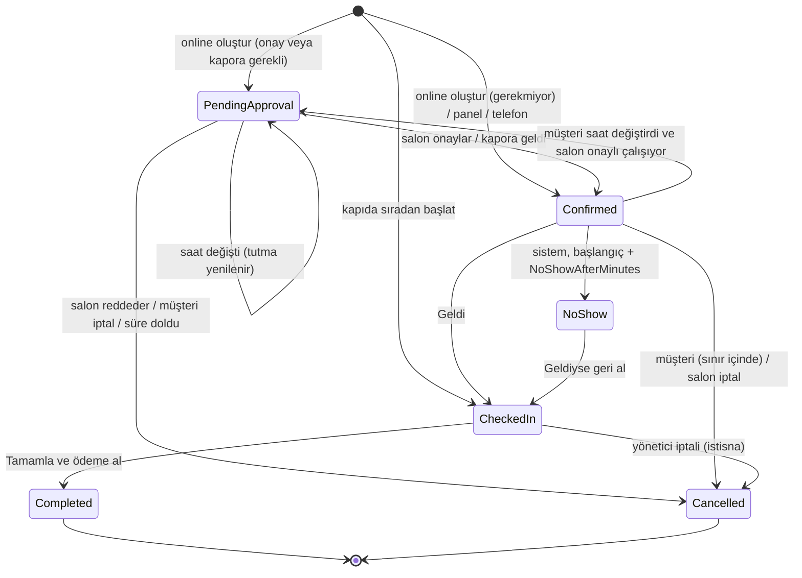
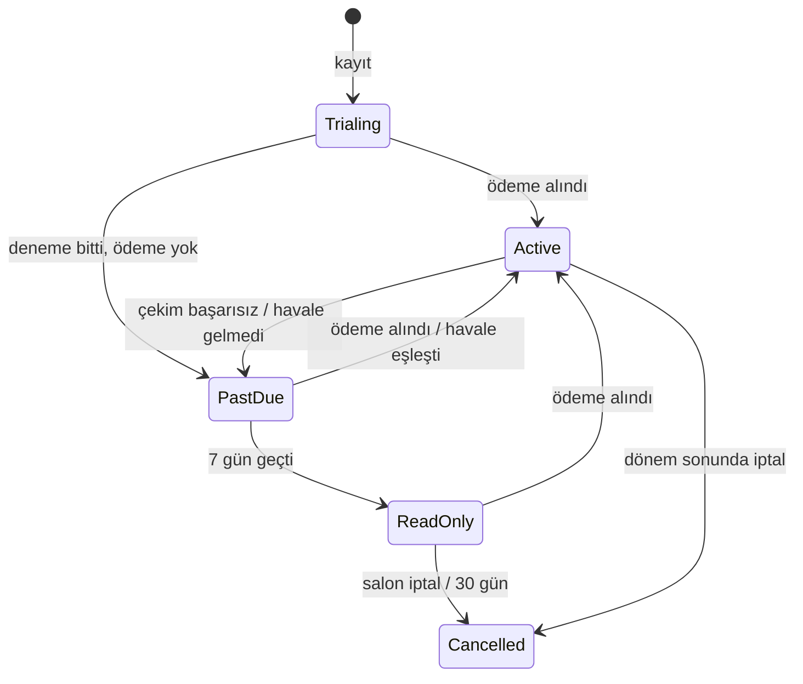

# Durum makineleri

Her durum değişikliği yalnız ilgili aggregate'in metoduyla yapılır (`appointment.Approve(...)`); durum alanına dışarıdan yazılmaz. İzin verilmeyen geçiş `DomainException` fırlatır. API bunu `409` + `code: invalid_state_transition` olarak döndürür.

Her geçişin testi zorunludur. `Scheduling.Domain.Tests` içinde her satır için en az bir test bulunur; tablo ile test listesi birebir eşleşir.

## 1. Randevu (`Appointment.Status`)

`Draft` enum'da durur ama **v1'de hiçbir akış Draft üretmez**. Online akışta saat seçimi ile oluşturma arasında tutma yapılmaz; saat o arada dolarsa oluşturma `409 slot_taken` döner ve "Saat az önce doldu" deseni gösterilir. Draft hiçbir ekranda görünmez.

### Oluşturma kuralı

| Kanal | Onay gerekli mi? | Kapora gerekli mi? | Başlangıç durumu | `HoldExpiresUtc` |
|---|---|---|---|---|
| Online | Hayır | Hayır | `Confirmed` | — |
| Online | Evet | Hayır | `PendingApproval` | şimdi + `ApprovalTimeoutMinutes` |
| Online | Hayır / Evet | Evet | `PendingApproval` | şimdi + `TransferWindowMinutes` |
| Panel, Telefon | — | Hayır (v1'de panel kapora istemez) | `Confirmed` | — |
| Kapıda (WalkIn) | — | — | `CheckedIn` | — |

- "Onay gerekli" = `Service.RequiresApproval ?? BrandSettings.RequiresApproval`. Randevudaki kalemlerden **biri** onay istiyorsa tüm randevu onay ister.
- "Kapora gerekli" çözümü [sureler-ve-ayarlar.md § Kapora](sureler-ve-ayarlar.md#kapora-ayarlar--kapora-ve-iban) içindedir. Randevunun kaporası, kalem kaporalarının toplamıdır.
- Kapora ve onay birlikte gerekiyorsa tek tutma süresi vardır: `TransferWindowMinutes`. Salonun "Kapora geldi" demesi onay sayılır.

### Geçiş tablosu

| # | Başlangıç | Hedef | Tetikleyen | Koşul / yetki | Yan etkiler |
|---|---|---|---|---|---|
| A1 | — | PendingApproval / Confirmed / CheckedIn | Online müşteri, salon, kapıda sıra | Müsaitlik; çakışma kısıtı | Segmentler yazılır; paket seansı ayrılır; `BrandCustomer` yoksa oluşur; bildirim (`appointment.requested` / `appointment.confirmed`); erişim kodu üretilir |
| A2 | PendingApproval | Confirmed | Salon "Onayla" | `appointment.approve` (Owner, BranchManager). Kapora istenmiş ve gelmemişse `waiveDeposit = true` zorunlu | `HoldExpiresUtc = null`, `ConfirmedUtc`; `appointment.confirmed` bildirimi; hatırlatmalar planlanır |
| A3 | PendingApproval | Confirmed | Salon "Kapora geldi" | `appointment.deposit.mark` (Owner, BranchManager; personel ayar açıksa) | `DepositReceivedUtc`; `Payment(Method=Transfer, IsDeposit)` + tahsis; `deposit.received` bildirimi |
| A4 | PendingApproval | Cancelled | Salon "Reddet" | `appointment.approve` | Neden `DeclinedBySalon`; segmentler pasif; seans geri; müşteriye "iptal" bildirimi; bekleme listesi tetiklenir |
| A5 | PendingApproval | Cancelled | Sistem | `HoldExpiresUtc <= şimdi` | Neden kapora istenmişse `DepositNotReceived`, değilse `ApprovalExpired`; A4 ile aynı yan etkiler |
| A6 | PendingApproval / Confirmed | Cancelled | Müşteri | Başlangıca kalan süre ≥ `CancellationCutoffHours` (PendingApproval'da sınır yok); neden zorunlu | `CancelledBy = Customer`; `BrandCustomer.CancelCount++`; seans geri; salona bildirim; bekleme listesi |
| A7 | PendingApproval / Confirmed | Cancelled | Salon | `appointment.cancel`; personel yalnız kendi randevusunu, ayar izin veriyorsa. Salon sınıra tabi değildir | Müşteriye bildirim (anahtar kapalıysa gönderilmez: "Müşteriye bildir"); seans geri; prim yok |
| A8 | Confirmed | NoShow | Sistem | `StartUtc + NoShowAfterMinutes <= şimdi` ve `CheckedInUtc` yok | `NoShowCount++`; segmentler pasif; seans **geri dönmez**; salon bildirimi ("Ece Koç gelmedi olarak işaretlendi") |
| A9 | NoShow | CheckedIn | Salon "Geldiyse geri al" | Aynı yerel gün içinde; `appointment.checkin` | `NoShowCount--`; segmentler yeniden aktif (çakışma olursa `409`) |
| A10 | Confirmed | CheckedIn | Salon "Geldi" | `appointment.checkin`; başlangıçtan en fazla 60 dk önce | `CheckedInUtc`; işletme uygulamasına bildirim (tercih açıksa) |
| A11 | CheckedIn | Completed | Salon "Tamamla ve ödeme al" | `appointment.complete` | Kalemler `Completed`; tahsilatlar kaydedilir; prim doğar; sayaçlar (`VisitCount`, `LastVisitOn`, `TotalSpentMinor`); değerlendirme daveti planlanır |
| A12 | CheckedIn | Cancelled | Yönetici | `appointment.cancel.checkedin` (Owner, BranchManager) | A7 gibi; neden zorunlu |
| A13 | Confirmed | PendingApproval | Müşteri saat değiştirir | Onay gerekli ve sınır içinde | Yeni `HoldExpiresUtc`; alınmış kapora korunur; salona bildirim |
| A14 | PendingApproval / Confirmed | (aynı) | Saat değişikliği | Müşteri: `RescheduleCutoffHours`; salon sınırsız | Kalemler ve segmentler yeniden yazılır (eski segmentler pasif, yenileri aktif, tek transaction); kapora yeni saate aktarılır; `appointment.rescheduled` bildirimi; hatırlatmalar yeniden planlanır |

### Değişmezler
- `HoldExpiresUtc` yalnız `PendingApproval`'da doludur.
- `Cancelled`, `NoShow`, `Completed` durumlarında segmentlerin `IsActive = false`'tur. `Completed`'da segment aktif kalır (geçmiş, çakışma açısından önemsiz).
- `Completed` ve `Cancelled` son durumlardır; geri alınmaz. Yanlış tamamlama v1'de "iade" ve "ters prim" ile düzeltilir.
- Müşteri `CheckedIn` ve sonrasında randevuyu değiştiremez.
- Sınır geçmişse müşteri arayüzünde buton yerine "Salonu arayın" gösterilir. API yine de `409 cutoff_passed` döner.

### Sistem işleri
| İş | Sıklık | Ne yapar |
|---|---|---|
| `ExpireAppointmentHolds` | her dakika | Süresi dolan `PendingApproval` → A5 |
| `MarkNoShows` | her dakika | A8 |
| `ScheduleReminders` | randevu oluşunca / değişince | Outbox'a `ScheduledUtc`'li hatırlatma satırları yazar |
| `ExtendRecurringSeries` | her gün 03:00 yerel | Seriyi 3 ay ileriye üretir |

Ayrıca: çakışma kontrolünden önce, aynı personelin süresi dolmuş tutmaları satır içinde iptal edilir. Böylece süresi geçmiş bir tutma, işin bir sonraki çalışmasını beklerken saati boşuna kilitlemez.

### Arayüz gösterimi (`displayStatus`)
API her randevuda `status` (gerçek durum) ve `displayStatus` (gösterim) döndürür:

| displayStatus | Koşul | Türkçe | Token |
|---|---|---|---|
| `PendingApproval` | PendingApproval ve kapora yok ya da alınmış | Onay bekliyor | `durum-onay-*` |
| `DepositPending` | PendingApproval + kapora istenmiş + alınmamış | Kapora bekleniyor | `durum-kapora-*` |
| `Confirmed` | | Onaylandı | `durum-onaylandi-*` |
| `CheckedIn` | | Geldi | `durum-geldi-*` |
| `Completed` | | Tamamlandı | `durum-tamamlandi-*` |
| `NoShow` | | Gelmedi | `durum-gelmedi-*` |
| `Cancelled` | | İptal | `durum-iptal-*` |

Ek bayrak: `depositCustomerReported: bool` ("Havaleyi yaptım" dendi; salon panelinde "Havale bildirildi · kontrol edin").

## 2. Kalem (`AppointmentItem.Status`)
`Active` → `Completed` (randevu tamamlanınca) | `Cancelled` (kalem randevudan çıkarılınca veya randevu iptal olunca). Kalemde NoShow yoktur.

## 3. Bekleme listesi

`WaitlistEntry.Status`: `Waiting` → `Converted` (teklif kabul edildi) | `Cancelled` ("Listeden çık") | `Expired` (istenen son tarih geçti).

`WaitlistOffer.Status`:

| Başlangıç | Hedef | Tetikleyen | Yan etki |
|---|---|---|---|
| — | Pending | Sistem: uygun saat boşaldı | `HoldExpiresUtc = şimdi + 15 dk`; saat geçici tutulur; `waitlist.offer` bildirimi (push → SMS) |
| Pending | Accepted | Müşteri "Randevuyu al" | Randevu oluşur (A1, online kuralları); entry `Converted` |
| Pending | Declined | Müşteri "Bu saat olmaz" | Sıradakine teklif |
| Pending | Expired | Sistem (`ExpireWaitlistOffers`, her dakika) | Sıradakine teklif; kişi listede kalır |
| Pending | Withdrawn | Salon "Teklifi geri al" (`waitlist.manage`) | Tutma kalkar, saat yeniden online görünür; otomatik olarak sıradakine teklif edilmez; kişi listede kalır; müşteriye bildirim yok |

Kaydın `Expired` olması: istenen günlerin hepsi şubenin bugününden önce kalınca `ExpireWaitlistEntries` işi (saatlik); gün listesi boşsa ("Herhangi bir gün") kayıt süresiz bekler. Teklif motoru, tutma ve uygunluk kuralları: `docs/acik-sorular.md` T-90.

## 4. Kapıda sıra (`WalkInTicket.Status`)
`Waiting` → `Called` (isteğe bağlı; "Sırası geldi" SMS'i) → `Served` (randevuya çevrildi) | `Left` ("Sıradan çıkar"). `Waiting` → `Served` doğrudan da olabilir ("Başlat").

## 5. Müşteri paketi (`CustomerPackage.Status`)
`Active` → `Expired` (sistem, `ExpiresOn` geçti; günlük iş) | `Refunded` (salon iade etti) | `Transferred` (başka müşteriye devredildi; `IsTransferable`).

## 6. Tahsilat (`Payment.Status`)
`Recorded` → `PartiallyRefunded` → `Refunded`; `Recorded` → `Voided` (yanlış giriş, yalnız aynı gün, yönetici).

## 7. Prim (`CommissionEntry.Status`)
`Accrued` → `Approved` → `Paid`. Herhangi bir durumdaki kayıt için ters kayıt (`Reversed`, eksi tutar) açılabilir; asıl kayıt değişmez.

## 8. Abonelik (`Subscription.Status`)

| Durum | Davranış |
|---|---|
| `Trialing` | Her şey açık; "Deneme sürenizin bitmesine 9 gün var" şeridi |
| `PastDue` | Her şey çalışır; turuncu şerit "Kartı güncelle / Havale ile öde"; 7 gün |
| `ReadOnly` | Online rezervasyon kapalı (public uçlar `403 booking_disabled`, sayfa "Online randevu kapalı · Salonu arayın"); yeni randevu, SMS ve kampanya kapalı; veriler görünür; kırmızı şerit. Var olan randevular durur, hatırlatmalar gider (işlem mesajı) |
| `Cancelled` | Panel kapalı; veri silinmez; 30 gün sonra arşiv (`Brand.Status = Archived`) |

Not: Teknik kurallardaki eski tabloya göre ReadOnly'de salon elle randevu ekleyebiliyordu. Tasarım ("yeni randevu, online rezervasyon ve SMS kapalı") daha yeni olduğu için yeni randevu da kapalıdır. → `docs/acik-sorular.md` S-05.

## 9. Bildirim (`NotificationOutbox.Status`)
`Pending` → `Sending` → `Sent` | `Failed` (deneme sınırı) | `Skipped` (rıza yok, kontör yok, alıcı anonim) | `Cancelled` (ilgili randevu iptal oldu). `Failed` olan push için plandaki sonraki kanal yeni satır olarak denenir.

## 10. Diğer

| Varlık | Durumlar |
|---|---|
| `Brand.Status` | `Onboarding` (kurulum adımları bitmedi) → `Active` → `Suspended` (platform askıya aldı) / `Archived` |
| `UserMembership.Status` | `Invited` → `Active` → `Disabled`; `Invited` → `Disabled` (personel pasife alındı, davet kapanır) |
| `BrandSmsSender.Status` | `Pending` → `Approved` / `Rejected` (yeniden başvuru yeni satır) |
| `PaymentNotice.Status` | `Pending` → `Matched` / `NotFound` ("Bulunamadı, markaya yaz") / `Rejected` |
| `DataDeletionRequest.Status` | `Pending` → `Completed` / `Rejected` |
| `CalendarLink.Status` | `Active` → `TokenExpired` (yenilenemedi; "Google Takvim bağlantısı koptu") / `Revoked` |
| `AppointmentSeries.Status` | `Active` ↔ `Paused` → `Ended` |
