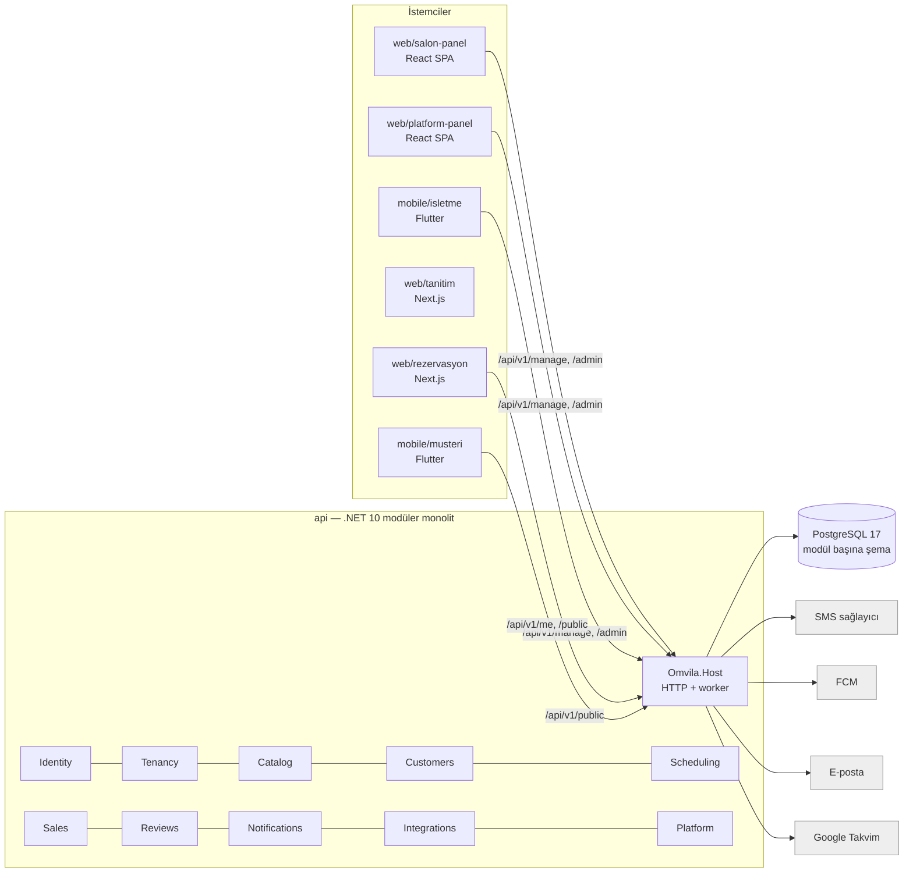

# Mimari

## Genel resim



- **Tek deploy birimi:** `Omvila.Host` aynı imajla iki rolde çalışır: `--role=api` (HTTP) ve `--role=worker` (zamanlanmış işler, outbox dağıtımı). Geliştirmede `--role=all`.
- **Tek veritabanı, modül başına şema:** `identity`, `tenancy`, `catalog`, `customers`, `scheduling`, `sales`, `reviews`, `notifications`, `integrations`, `platform`, `infra`.
- **Sözleşme önce:** HTTP yüzeyi `contracts/openapi.yaml`'dır. Backend bu sözleşmeye uyar; istemciler bu sözleşmeden üretilir (ADR-0009).

## API yüzeyleri

| Önek | Kim | Kimlik | Hız sınırı |
|---|---|---|---|
| `/api/v1/manage` | Salon paneli, işletme uygulaması | JWT `aud=manage` | Kullanıcı başına |
| `/api/v1/admin` | Platform paneli | JWT `aud=admin` + `PlatformRole` | Kullanıcı başına |
| `/api/v1/me` | Müşteri uygulaması | JWT `aud=me` | Müşteri başına |
| `/api/v1/public` | Rezervasyon sayfası, müşteri uygulaması (randevu alma) | Anonim; yazma uçlarında `aud=public-booking` veya `aud=me`; SMS bağlantısı uçlarında erişim kodu | IP + telefon başına, sıkı |

Her yüzeyin kendi yetkilendirme politikası, CORS ayarı ve hız sınırı vardır. Bir yüzeyin jetonu diğerinde geçmez.

## Backend çözüm yapısı

```
api/
  Omvila.slnx
  Directory.Build.props        # ortak ayarlar: net10.0, Nullable, TreatWarningsAsErrors, analyzers
  Directory.Packages.props     # merkezi paket sürümleri
  src/
    Omvila.Host/               # Program.cs, kompozisyon kökü, auth, OpenAPI, worker rolü
    Omvila.SharedKernel/       # Result/Error, DomainException, Money, PhoneNumber, Ids, IClock
    Omvila.Infrastructure/     # Postgres bağlantısı, RLS, outbox, iş zamanlayıcı, idempotency, dış servis adaptörleri
    Modules/
      Scheduling/
        Omvila.Modules.Scheduling/            # modülün kendisi (iç yapısı aşağıda)
        Omvila.Modules.Scheduling.Contracts/  # diğer modüllere açılan arayüzler, DTO'lar, olaylar
      Identity/ Tenancy/ Catalog/ Customers/ Sales/ Reviews/ Notifications/ Integrations/ Platform/
  tests/
    Omvila.Modules.Scheduling.Tests/          # alan + uygulama birim testleri
    Omvila.Modules.Scheduling.IntegrationTests/  # Testcontainers PostgreSQL
    Omvila.ArchitectureTests/                 # katman ve modül sınırı kuralları
    Omvila.Api.ContractTests/                 # yanıtların openapi.yaml'a uygunluğu
```

### Bir modülün içi

```
Omvila.Modules.Scheduling/
  Domain/                  # aggregate'ler, değer nesneleri, alan olayları, saf servisler (Availability/)
  Features/                # dikey dilimler: her özellik bir klasör
    CreateAppointment/
      CreateAppointmentEndpoint.cs     # HTTP eşlemesi (Minimal API)
      CreateAppointmentRequest.cs      # sözleşmedeki şemaya birebir
      CreateAppointmentHandler.cs      # iş akışı: yükle → alan metodunu çağır → kaydet
      CreateAppointmentValidator.cs    # FluentValidation; yalnız biçim kuralları
    ApproveAppointment/ ...
  Infrastructure/
    SchedulingDbContext.cs
    Configurations/        # EF IEntityTypeConfiguration sınıfları
    Migrations/
  Jobs/                    # ExpireAppointmentHolds, MarkNoShows ...
  IntegrationEventHandlers/
  SchedulingModule.cs      # AddSchedulingModule(), MapSchedulingEndpoints()
```

## Katman kuralları (mimari testlerle zorlanır)

1. `Domain` hiçbir şeye bağımlı değildir: yalnız `SharedKernel` ve NodaTime. EF, ASP.NET, `HttpContext`, `DbContext`, `DateTime.Now`, `Guid.NewGuid()` yasaktır (kimlik ve saat dışarıdan verilir).
2. `Features` `Domain`'i ve kendi modülünün `Infrastructure`'ını kullanır. Başka modülün yalnız `.Contracts` projesine bağımlı olabilir.
3. Bir modül başka modülün iç projesine (`Omvila.Modules.X`) **referans veremez**. Yalnız `Omvila.Modules.X.Contracts`'a verebilir.
4. Bir modül başka modülün tablosunu sorgulayamaz; SQL'de başka şema adı geçemez.
5. Uç nokta sınıfları iş kuralı içermez; handler'ı çağırıp sonucu HTTP'ye çevirir.
6. MediatR, AutoMapper, repository-over-DbContext soyutlaması kullanılmaz. Handler `DbContext`'i doğrudan kullanır; eşleme elle yazılır.
7. `public` görünürlük yalnız `Contracts` projelerinde ve modül giriş sınıfında; modül içi tipler `internal`. Testler `InternalsVisibleTo` ile erişir.

## Modüller arası iletişim

| İhtiyaç | Yöntem | Örnek |
|---|---|---|
| Aynı transaction'da olması **zorunlu** iş | Senkron çağrı: `Contracts` arayüzü, aynı bağlantı ve transaction | Randevu oluşurken `ICustomerDirectory.EnsureBrandCustomer`, `IPackageLedger.ReserveSession` |
| Okuma (başka modülün verisini göstermek) | Senkron sorgu arayüzü | `ICatalogQueries.GetServicePlans(...)` |
| Yan etki (bildirim, sayaç, prim, takvim aktarımı) | Entegrasyon olayı → `infra.outbox_events` (aynı transaction) → worker → ilgili modülün handler'ı | `AppointmentCompleted` → Sales (prim), Customers (sayaç), Reviews (davet), Notifications |

- **Tek bağlantı, tek transaction:** HTTP isteği başına bir `NpgsqlConnection` ve bir transaction açılır. Tüm modül `DbContext`'leri bunu paylaşır (`UseTransaction`). Kiracı ayarları (`SET LOCAL app.brand_id`) bu transaction'a uygulanır (ADR-0006).
- **Olaylar en az bir kez teslim edilir.** Handler idempotent yazılır (işlenen olay kimlikleri `infra.processed_events`).
- Olay adları geçmiş zamandır (`AppointmentCancelled`). Şema `Contracts` içinde `record` olarak durur ve sürümlenir.

## Arka plan işleri
Bkz. ADR-0005. Özet: Hangfire yok. Zamana bağlı işler veriden türer (`HoldExpiresUtc`, `ScheduledUtc`). Worker her dakika süresi gelen satırları `FOR UPDATE SKIP LOCKED` ile alır. Periyodik işler `infra.job_runs` tablosunda izlenir. Aynı anda tek worker'ın çalışması advisory lock ile sağlanır.

| İş | Modül | Sıklık |
|---|---|---|
| `ExpireAppointmentHolds` | Scheduling | 1 dk |
| `MarkNoShows` | Scheduling | 1 dk |
| `ExpireWaitlistOffers` | Scheduling | 1 dk |
| `ExtendRecurringSeries` | Scheduling | günlük |
| `DispatchNotifications` | Notifications | sürekli (1 sn bekleme) |
| `DispatchIntegrationEvents` | Infrastructure | sürekli |
| `ExpireCustomerPackages` | Sales | günlük |
| `AdvanceSubscriptionStatuses` | Platform | saatlik |
| `RefreshCalendarTokens`, `SyncCalendarEvents` | Integrations | 5 dk |
| `ProcessDeletionRequests`, `ApplyRetention` | Customers | günlük |

## Kesişen konular

| Konu | Karar |
|---|---|
| Zaman | NodaTime (`Instant`, `LocalDate`, `LocalTime`, `IClock`); Npgsql NodaTime eklentisi. `DateTime` alan modelinde yasak (ADR-0003) |
| Kimlik üretimi | `Guid.CreateVersion7()`; alan katmanına `IIdGenerator` ile |
| Doğrulama | FluentValidation (biçim); iş kuralları alan katmanında |
| Hata | `Result<T>` + `Error(code, …)`; HTTP'de RFC 9457 `application/problem+json` (bkz. `docs/sozlesme/api-kurallari.md`) |
| Günlük | Serilog, yapılandırılmış JSON; PII (telefon, ad) maskelenir; her satırda `traceId`, `brandId` |
| İzleme | OpenTelemetry (trace + metric); kritik metrikler: randevu oluşturma süresi, `slot_taken` oranı, outbox gecikmesi, SMS hata oranı |
| Yapılandırma | `appsettings.json` + ortam değişkenleri; gizli değerler kasada (barındırmaya göre). Kodda gizli değer yok |
| Şifreleme | IBAN ve OAuth jetonları uygulama düzeyinde şifreli (ASP.NET Data Protection, anahtar kasada) |
| Hız sınırı | ASP.NET `RateLimiter`; OTP uçlarına telefon + IP bazlı ayrı politikalar |
| Dosya | `IFileStorage` (S3 uyumlu); yüklemede boyut ve MIME kontrolü |
| Dış servisler | `ISmsSender`, `IPushSender`, `IEmailSender`, `ICalendarProvider`; her birinin geliştirme ve test için sahte uygulaması |
| Sağlık | `/health/live`, `/health/ready` (DB, outbox gecikmesi) |

## İstemci tarafı (özet)
- **Web paneller** (`web/salon-panel`, `web/platform-panel`): React 19 + TypeScript + Vite SPA, TanStack Router + TanStack Query. Sözleşmeden üretilmiş `packages/api-client-ts`. UI `packages/ui-web` (panel tasarım sistemi bileşenleri, yeniden yazılmış hâli). Tokenlar `packages/design-tokens`'dan.
- **Rezervasyon** (`web/rezervasyon`): Next.js App Router. Salon sayfası sunucuda render edilir (önizleme meta etiketleri, hızlı ilk yükleme); adımlar istemcide. Aynı `api-client-ts` ve mobil tasarım sistemi ölçüleriyle.
- **Tanıtım** (`web/tanitim`): Next.js, statik üretim.
- **Mobil** (`mobile/isletme`, `mobile/musteri`): Flutter 3.27+, Riverpod, go_router, `packages/api-client-dart` (sözleşmeden üretilmiş), ortak widget paketi `packages/omvila_ui` (tema `omvila_theme.dart` dahil).

Ayrıntılar her projenin `AGENTS.md` dosyasında.

## ADR listesi

| # | Konu |
|---|---|
| [0001](adr/0001-veritabani-postgresql.md) | Veritabanı: PostgreSQL |
| [0002](adr/0002-moduler-monolit.md) | Modüler monolit ve modül sınırları |
| [0003](adr/0003-zaman-ve-saat-dilimi.md) | Zaman: UTC saklama, NodaTime, yerel çalışma saatleri |
| [0004](adr/0004-cakisma-engeli.md) | Çakışan randevu engeli |
| [0005](adr/0005-arka-plan-isleri-ve-outbox.md) | Arka plan işleri ve outbox |
| [0006](adr/0006-cok-kiracilik.md) | Çok kiracılık: EF filtresi + PostgreSQL RLS |
| [0007](adr/0007-kimlik-dogrulama.md) | Kimlik doğrulama ve oturum |
| [0008](adr/0008-web-catisi.md) | Web çatısı |
| [0009](adr/0009-sozlesme-once.md) | Sözleşme önce: OpenAPI ve istemci üretimi |
| [0010](adr/0010-monorepo-ve-araclar.md) | Monorepo ve araçlar |

Yeni bir mimari karar ADR olmadan uygulanmaz. Şablon: [adr/0000-sablon.md](adr/0000-sablon.md).
