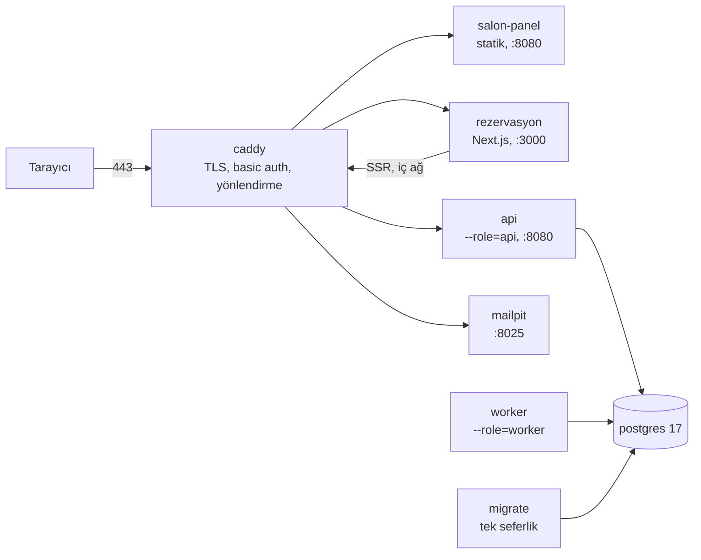

# Test ortamı (staging)

Ürün sahibinin demo yaptığı ve uçtan uca denemelerin yapıldığı tek sunucu. Canlı ortam değildir: gerçek kişi verisi girilmez, SMS ve push sahte sağlayıcıyla çalışır (gerçek SMS sağlayıcısı canlıya çıkışta seçilir, T-03). Kararlar ve varsayımlar: [acik-sorular.md](../acik-sorular.md) T-73 (API'nin Staging ortamı), T-74 (demo verisi), T-75 (imajlar ve compose), T-76 (SMS günlüğü, ters vekil).

## Ortamlar

| Ortam | Nerede | Veri | SMS / push |
|---|---|---|---|
| Development | Geliştiricinin bilgisayarı (`docker compose up -d`, `--role=all`) | Demo verisi (`--role=seed`) | Sahte; metin konsolda |
| Testing | Otomatik testler (WebApplicationFactory, Testcontainers) | Test başına | Sahte |
| Staging | Bu belge: tek sunucu, Docker Compose | Demo verisi; gerçek kişi yok | Sahte (`Staging__AllowFakeProviders=true`); metin yalnız SMS günlüğü sayfasında |
| Production | Henüz yok (barındırma T-07) | Gerçek | Gerçek sağlayıcı; sahte sağlayıcı hiçbir ayarla açılmaz |

## Adresler

| Adres | Ne | Erişim |
|---|---|---|
| `https://test.salon.omvila.com.tr` | Salon paneli | Basic auth, ardından telefon + SMS kodu |
| `https://test.randevu.omvila.com.tr` | Rezervasyon sayfası (demo: `/kuafor-elif`) | Basic auth |
| `https://test.api.omvila.com.tr` | API | Açık (tarayıcı çapraz köken isteğinde basic auth göndermez); SMS günlüğü yolu bu adreste 404 |
| `https://test.sms.omvila.com.tr` | Sahte SMS günlüğü (giriş kodları burada) | Basic auth |
| `https://test.posta.omvila.com.tr` | Mailpit (e-posta altyapısı gelince) | Basic auth |

Bütün yanıtlarda `X-Robots-Tag: noindex, nofollow` vardır. Basic auth kullanıcısı tektir; parolayı ürün sahibi ve geliştiriciler bilir, depoya girmez.

## Yapı



- Tanım: [`deploy/staging/compose.yml`](../../deploy/staging/compose.yml), kenar sunucusu [`deploy/staging/Caddyfile`](../../deploy/staging/Caddyfile), ortam değişkenleri [`deploy/staging/env.example`](../../deploy/staging/env.example).
- Dışarı yalnız Caddy açılır (80, 443/tcp, 443/udp). Postgres, API, worker ve Mailpit yalnız compose iç ağındadır.
- İç ağın alt ağı sabittir (`STAGING_SUBNET`, varsayılan `172.30.0.0/24`). API, `X-Forwarded-For` ve `X-Forwarded-Proto` başlıklarına yalnız bu ağdan gelirse güvenir; OTP'nin IP başına sınırı böylece ziyaretçinin gerçek IP'sini görür.
- api, worker, migrate ve seed aynı imajdır; yalnız `--role` değişir. `migrate` her açılışta önce çalışır ve çıkar; api ve worker onu bekler.
- İmajlar: `ghcr.io/sefabarlas/omvila-<api|salon-panel|rezervasyon>:<TAG>`. API ve site adresleri web imajlarına derlemede gömülür; adres değişirse web imajları yeniden derlenir.

## Sunucu gereksinimleri

- Linux (Ubuntu 24.04 LTS önerilir), Docker Engine ve Docker Compose eklentisi.
- En az 2 vCPU, 4 GB bellek, 40 GB disk (varsayım: yalnız demo verisi; ilk sunucu kendi üstünde derlerse derleme sırasında bellek sınırda kalabilir).
- Güvenlik duvarı: 22 (SSH, mümkünse yalnız bilinen IP'lerden), 80, 443/tcp, 443/udp. Başka port açılmaz.
- Barındırma yurt içi seçilirse canlıya geçişte aynı sağlayıcı değerlendirilebilir (T-07); test ortamı gerçek kişi verisi taşımadığından bu karar ona bağlı değildir.

## İlk kurulum

1. **DNS:** beş adres için sunucunun IP'sine ayrı A kaydı (IPv6 varsa AAAA da) açın: `test.salon`, `test.api`, `test.randevu`, `test.sms`, `test.posta` (`omvila.com.tr` altında). Caddy ilk açılışta Let's Encrypt sertifikası alır; kayıtlar yayılmadan başlatılırsa sertifika alınamaz ve Caddy bir süre sonra yeniden dener.
2. **Depo:** sunucuda depoyu klonlayın (compose dosyası, Caddyfile ve veritabanı açılış betikleri depodan okunur):
   ```bash
   git clone https://github.com/sefabarlas/omvila.git /opt/omvila && cd /opt/omvila
   ```
3. **Gizli değerler:** `cp deploy/staging/env.example deploy/staging/.env` ve değerleri doldurun. Dosya `.gitignore`'dadır; yalnız sunucuda durur ve yedeği parola yöneticisinde tutulur. Her değerin üretim komutu `env.example`'da yazar:

   | Değişken | Ne | Üretim |
   |---|---|---|
   | `OMVILA_MIGRATOR_DB_PASSWORD` | Postgres süper kullanıcısı ve tablo sahibi | `openssl rand -base64 32 \| tr -d '/+='` |
   | `OMVILA_APP_DB_PASSWORD` | Uygulama rolü (RLS'e tabi) | aynı |
   | `AUTH_SIGNING_KEY_ID`, `AUTH_SIGNING_KEY_PEM` | JWT imza anahtarı (ES256, P-256) | `openssl ecparam -name prime256v1 -genkey -noout \| openssl pkcs8 -topk8 -nocrypt` |
   | `AUTH_OTP_HMAC_KEY` | OTP kod özeti anahtarı | `openssl rand -base64 32` |
   | `SMS_FAKE_WEBHOOK_SECRET` | Sahte sağlayıcının teslim raporu imzası | `openssl rand -hex 32` |
   | `BASIC_AUTH_USER`, `BASIC_AUTH_HASH` | Basic auth kullanıcısı ve bcrypt özeti | `docker run --rm caddy:2 caddy hash-password --plaintext '<parola>'` |

   Test ortamının anahtarları canlıda kullanılmaz; canlı için ayrı üretilir.
4. **Başlatma:**
   ```bash
   docker compose -f deploy/staging/compose.yml --env-file deploy/staging/.env up -d --build --wait
   ```
   Dağıtım iş akışı GHCR'a imaj itmeye başladığında `--build` yerine `TAG=<sürüm>` ile `pull` kullanılır (bkz. Güncelleme).
5. **Demo verisi:**
   ```bash
   docker compose -f deploy/staging/compose.yml --env-file deploy/staging/.env --profile seed run --rm seed
   ```
6. **Denetim:** `https://test.api.omvila.com.tr/health/ready` 200 dönmeli; `https://test.salon.omvila.com.tr`'de basic auth'tan sonra giriş ekranı açılmalı.

## Demo verisi

`--role=seed` "Kuaför Elif" markasını kurar (`kuafor-elif`; Kadıköy ve Nişantaşı şubeleri, 10 hizmet, 15 müşteri, son ve gelecek iki haftanın randevuları, 1000 kontör). Kişiler uydurmadır.

| Telefon | Kişi | Rol |
|---|---|---|
| 0555 000 00 01 | Elif Kaya | Sahip |
| 0555 000 00 02 | Mert Demir | Personel |
| 0555 000 00 03 | Can Yücel | Personel |
| 0555 000 00 04 | Zeynep Aksoy | Şube yöneticisi |

Giriş: salon panelinde telefonu yazın, gelen kodu `https://test.sms.omvila.com.tr`'den okuyun (en yeni üstte; `?telefon=05550000001` ile süzülür).

- Komut idempotenttir: marka varsa bir şey yazmaz.
- **Demodan önce sıfırlama:** randevu tarihleri çalıştırma anına göre yazıldığından demodan önce yenileyin. `--reset` yalnız demo markasını silip yeniden kurar; başka markalara dokunmaz:
  ```bash
  docker compose -f deploy/staging/compose.yml --env-file deploy/staging/.env --profile seed run --rm seed --role=seed --reset
  ```
- Test ortamında kayıt akışıyla açılan markalar da gerçek kişi verisi taşımamalıdır; deneme için `0555 000 …` biçimli uydurma numaralar kullanın.

## Günlük işler

Kısaltma olarak (sunucuda `/opt/omvila` içinde):

```bash
alias dc='docker compose -f deploy/staging/compose.yml --env-file deploy/staging/.env'
```

| İş | Komut |
|---|---|
| Durum | `dc ps` |
| Günlük | `dc logs -f api worker` (SMS metni, telefon, ad günlüğe yazılmaz) |
| Yeniden başlatma | `dc restart api worker` |
| Durdurma (veri kalır) | `dc down` |
| Veritabanına bağlanma | `dc exec postgres psql -U omvila_migrator -d omvila` |

### Güncelleme

Dağıtım iş akışı gelene kadar elle:

```bash
git pull && dc up -d --build --wait
```

Migration'lar `migrate` hizmetiyle kendiliğinden uygulanır. Dağıtım iş akışı (GitHub Actions, `staging` ortamı) main'e birleşen her değişiklikte imajları GHCR'a iter, sunucuya SSH ile bağlanıp `TAG`'i değiştirir, `dc pull && dc up -d --wait` çalıştırır ve `/health/ready`'yi bekler. Sunucu IP'si ve SSH kullanıcısı belli olunca eklenecek.

### Yedek ve geri yükleme

Test ortamında yalnız demo verisi olduğundan yedek zorunlu değildir; demo verisi her zaman yeniden kurulabilir. Elle denemede oluşan veriyi saklamak gerekirse:

```bash
dc exec -T postgres pg_dump -U omvila_migrator -d omvila -Fc > omvila-$(date +%F).dump
dc exec -T postgres pg_restore -U omvila_migrator -d omvila --clean --if-exists < omvila-2026-11-21.dump
```

### Parola veya anahtar değiştirme

- `OMVILA_APP_DB_PASSWORD` yalnız veritabanı birimi ilk açıldığında uygulanır. Sonradan değiştirmek için önce veritabanında, sonra `.env`'de değiştirip api ve worker'ı yeniden başlatın:
  ```bash
  dc exec postgres psql -U omvila_migrator -d omvila -c "ALTER ROLE omvila_app PASSWORD '<yeni>'"
  ```
- `OMVILA_MIGRATOR_DB_PASSWORD` için aynısı `ALTER ROLE omvila_migrator` ile yapılır.
- İmza anahtarı değişirse açık oturumlar düşer; kullanıcılar yeniden giriş yapar. OTP anahtarı değişirse bekleyen kodlar geçersiz olur.
- Basic auth parolası: yeni özeti `.env`'ye yazın, `dc up -d caddy`.

### Tamamen sıfırlama

`dc down -v` veritabanı ve sertifika birimlerini **kalıcı olarak siler**. Ardından `dc up -d --build --wait` ve demo verisi komutu. Sertifika birimini silmek Let's Encrypt sınırlarına takılabilir; yalnız veritabanını silmek için `docker volume rm omvila-staging_pgdata` kullanın (önce `dc down`).

## Bilinen sınırlar

- **Sahte SMS ve push:** hiçbir telefona SMS gitmez; kodlar ve mesajlar yalnız SMS günlüğü sayfasındadır. Gerçek sağlayıcı canlıya çıkışta (T-03).
- **E-posta:** e-posta altyapısı henüz yok; Mailpit boş kalır.
- **DataProtection anahtarları** kapsayıcı içinde: api yeniden başlayınca açılışta uyarı yazar. Şu an bu anahtarlarla korunan kalıcı veri yok (T-75 (12)).
- **Tek sunucu:** yedeklilik ve ölçekleme yok; bakım sırasında ortam kapalıdır.
- **Deneme kontörü:** kayıt akışıyla açılan markaya deneme hediyesi kontörü yazılmaz (değer belirlenmedi, T-73 (5)); demo markasında 1000 kontör vardır.

## Yerel deneme

Staging yığınını kendi bilgisayarınızda `*.localhost:8443` adresleriyle çalıştırmak için [`deploy/staging/compose.local.yml`](../../deploy/staging/compose.local.yml) (Caddy iç CA kullanır; tarayıcı sertifika uyarısı verir). Gizli değerleri `deploy/staging/.env.local`'e veya kabuk ortamına yazın; her denemede yeni parola üretiyorsanız önce `down -v` ile birimi silin, yoksa veritabanı eski parolayı bekler.
