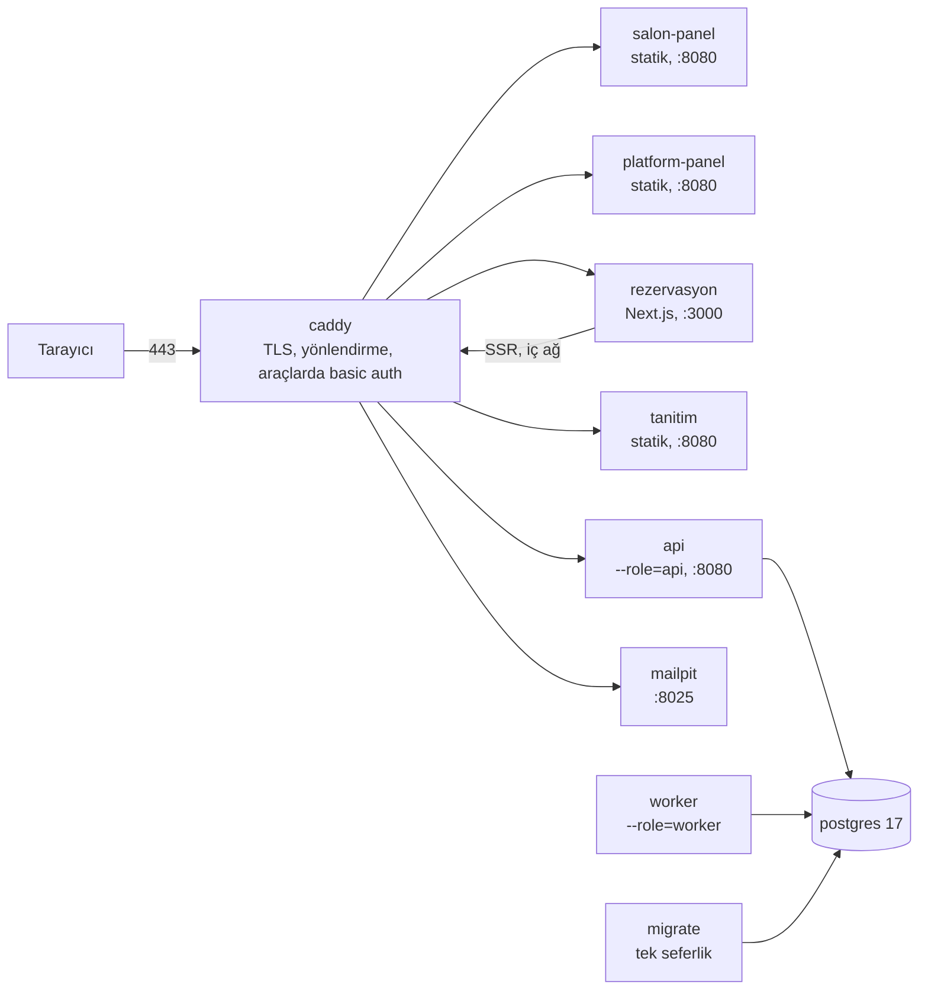

# Test ortamı (staging)

Ürün sahibinin demo yaptığı ve uçtan uca denemelerin yapıldığı tek sunucu. Canlı ortam değildir: gerçek kişi verisi girilmez, SMS ve push sahte sağlayıcıyla çalışır (gerçek SMS sağlayıcısı canlıya çıkışta seçilir, T-03). Kararlar ve varsayımlar: [acik-sorular.md](../acik-sorular.md) T-73 (API'nin Staging ortamı), T-74 (demo verisi), T-75 (imajlar ve compose), T-76 (SMS günlüğü, ters vekil).

## Ortamlar

| Ortam | Nerede | Veri | SMS / push |
|---|---|---|---|
| Development | Geliştiricinin bilgisayarı (`docker compose up -d`, `--role=all`) | Demo verisi (`--role=seed`) | Sahte; metin konsolda |
| Testing | Otomatik testler (WebApplicationFactory, Testcontainers) | Test başına | Sahte |
| Staging | Bu belge: tek sunucu, Docker Compose | Demo verisi; gerçek kişi yok | Sahte (`Staging__AllowFakeProviders=true`); metin yalnız SMS günlüğü sayfasında |
| Production | Henüz yok (barındırma T-07) | Gerçek | Gerçek sağlayıcı; sahte sağlayıcı hiçbir ayarla açılmaz |

## Adresler

| Adres | Ne | Erişim |
|---|---|---|
| `https://salon.test.omvila.com.tr` | Salon paneli | Telefon + SMS kodu |
| `https://admin.test.omvila.com.tr` | Platform paneli (iç ekip) | Platform kullanıcısının telefonu + SMS kodu ([Platform kullanıcısı](#platform-kullanıcısı)) |
| `https://randevu.test.omvila.com.tr` | Rezervasyon sayfası (demo: `/kuafor-elif`) | Açık |
| `https://www.test.omvila.com.tr` | Tanıtım sitesi (statik; robots.txt ve meta robots ile de kapalı) | Açık |
| `https://api.test.omvila.com.tr` | API | Açık (tarayıcı çapraz köken isteğinde basic auth göndermez); SMS günlüğü yolu bu adreste 404 |
| `https://sms.test.omvila.com.tr` | Sahte SMS günlüğü (giriş kodları burada) | Basic auth |
| `https://posta.test.omvila.com.tr` | Mailpit (e-posta altyapısı gelince) | Basic auth |

Bütün yanıtlarda `X-Robots-Tag: noindex, nofollow` vardır. Basic auth yalnız geliştirici araçlarındadır (sms, posta: giriş kodları ve e-postalar); ürün yüzeyleri ürün sahibinin kararıyla açıktır (2026-11-23). Basic auth kullanıcısı tektir; parolayı ürün sahibi ve geliştiriciler bilir, depoya girmez.

## Yapı



- Tanım: [`deploy/staging/compose.yml`](../../deploy/staging/compose.yml), kenar sunucusu [`deploy/staging/Caddyfile`](../../deploy/staging/Caddyfile), ortam değişkenleri [`deploy/staging/env.example`](../../deploy/staging/env.example).
- Dışarı yalnız Caddy açılır (80, 443/tcp, 443/udp). Postgres, API, worker ve Mailpit yalnız compose iç ağındadır.
- İç ağın alt ağı sabittir (`STAGING_SUBNET`, varsayılan `172.30.0.0/24`). API, `X-Forwarded-For` ve `X-Forwarded-Proto` başlıklarına yalnız bu ağdan gelirse güvenir; OTP'nin IP başına sınırı böylece ziyaretçinin gerçek IP'sini görür.
- api, worker, migrate ve seed aynı imajdır; yalnız `--role` değişir. `migrate` her açılışta önce çalışır ve çıkar; api ve worker onu bekler.
- İmajlar: `ghcr.io/sefabarlas/omvila-<api|salon-panel|platform-panel|rezervasyon|tanitim>:<TAG>`. API ve site adresleri web imajlarına derlemede gömülür; adres değişirse web imajları yeniden derlenir.

## Sunucu

- Hostinger KVM 2 VPS (Almanya), 21 Kasım 2026'da 12 aylık alındı. Ubuntu 26.04 LTS, 2 vCPU, 8 GB bellek, 96 GB disk, 2 GB takas. Adres ve erişim ekipte bilinir; depo herkese açık olduğundan burada yazmaz. Komutlarda `<sunucu>` olarak geçer.
- Erişim yalnız SSH anahtarıyla, `deploy` kullanıcısıyla (root ve parola girişi kapalı; `deploy` parolasız sudo yetkili).
- Güvenlik duvarı (ufw): yalnız 22, 80, 443 (tcp ve udp).
- Docker Engine 29 ve Compose v5, resmi Docker deposundan.
- Hostinger'ın ücretsiz haftalık yedeği açık; ücretli günlük yedek alınmadı (veritabanı yedeği aşağıda).
- Canlı barındırma ayrı karardır (T-07); test ortamı gerçek kişi verisi taşımadığından ona bağlı değildir.

Sunucudaki düzen:

| Yol | Ne |
|---|---|
| `/srv/omvila/app` | Çalışan kaynak kopyası (`git archive`; hangi commit olduğu `REVISION` dosyasında). Git deposu değildir. |
| `/srv/omvila/app.prev` | Bir önceki dağıtımın kopyası |
| `/srv/omvila/staging.env` | Gizli değerler ve adresler (izin 600) |
| `/srv/omvila/basic-auth.txt` | Basic auth parolasının açık hâli (izin 600) |
| `/srv/omvila/bin/pg-backup.sh` | Günlük veritabanı yedeği betiği |
| `/srv/omvila/backups` | Yedekler (14 gün) |

## İlk kurulum

Test sunucusu 21 Kasım 2026'da bu adımlarla kuruldu. Yeniden kurmak veya ikinci bir sunucu açmak için:

1. **DNS:** Cloudflare'de `*.test.omvila.com.tr` için sunucunun IP'sine joker A kaydı açın. Proxy **kapalı** olmalı (gri bulut): Cloudflare'in ücretsiz sertifikası ikinci düzey jokeri kapsamaz, sertifikayı Caddy Let's Encrypt'ten alır. Kayıt yayılmadan yığın başlatılırsa sertifika alınamaz, Caddy bir süre sonra yeniden dener.
2. **Sunucu:** `deploy` kullanıcısı (SSH anahtarı, sudo), ufw, Docker ve `/srv/omvila` klasörü (sahibi `deploy`).
3. **Gizli değerler:** [`deploy/staging/env.example`](../../deploy/staging/env.example)'ı `/srv/omvila/staging.env` olarak kopyalayın (`chmod 600`) ve doldurun. Dosya depoya girmez; yedeği parola yöneticisinde tutulur. Her değerin üretim komutu `env.example`'da yazar:

   | Değişken | Ne | Üretim |
   |---|---|---|
   | `OMVILA_MIGRATOR_DB_PASSWORD` | Postgres süper kullanıcısı ve tablo sahibi | `openssl rand -base64 32 \| tr -d '/+='` |
   | `OMVILA_APP_DB_PASSWORD` | Uygulama rolü (RLS'e tabi) | aynı |
   | `AUTH_SIGNING_KEY_ID`, `AUTH_SIGNING_KEY_PEM` | JWT imza anahtarı (ES256, P-256) | `openssl ecparam -name prime256v1 -genkey -noout \| openssl pkcs8 -topk8 -nocrypt` |
   | `AUTH_OTP_HMAC_KEY` | OTP kod özeti anahtarı | `openssl rand -base64 32` |
   | `TENANCY_IBAN_KEY` | Kapora IBAN'ı şifreleme anahtarı (AES-256-GCM, tam 32 bayt; değişirse kayıtlı IBAN'lar okunamaz) | `openssl rand -base64 32` |
   | `SMS_FAKE_WEBHOOK_SECRET` | Sahte sağlayıcının teslim raporu imzası | `openssl rand -hex 32` |
   | `BASIC_AUTH_USER`, `BASIC_AUTH_HASH` | Basic auth kullanıcısı ve bcrypt özeti | `docker run --rm caddy:2 caddy hash-password --plaintext '<parola>'` |

   Test ortamının anahtarları canlıda kullanılmaz; canlı için ayrı üretilir.
4. **İlk dağıtım** (kendi bilgisayarınızdan, depo kökünde; bkz. Güncelleme):
   ```bash
   STAGING_SSH=deploy@<sunucu> deploy/staging/deploy.sh
   ```
5. **Demo verisi:** sunucuda, aşağıdaki `dc` kısaltmasıyla `dc --profile seed run --rm seed`.
6. **Yedek zamanlayıcısı:** `pg-backup.sh` ve systemd `omvila-backup.service` + `omvila-backup.timer` (her gün 00:30 UTC).
7. **Denetim:** `https://api.test.omvila.com.tr/health/ready` 200 dönmeli; `https://salon.test.omvila.com.tr`'de giriş ekranı açılmalı.

## Demo verisi

`--role=seed` "Kuaför Elif" markasını ve abonelik durumu örneği iki küçük markayı (Berber Kemal, Nar Güzellik; Dilim 6) kurar. Kuaför Elif: (`kuafor-elif`; Kadıköy ve Nişantaşı şubeleri, 10 hizmet, 15 müşteri, son ve gelecek iki haftanın randevuları, kapora hesabı, 1000 kontör). Kişiler uydurmadır.

| Telefon | Kişi | Rol |
|---|---|---|
| 0555 000 00 01 | Elif Kaya | Sahip |
| 0555 000 00 02 | Mert Demir | Personel |
| 0555 000 00 03 | Can Yücel | Personel |
| 0555 000 00 04 | Zeynep Aksoy | Şube yöneticisi (Nişantaşı) |
| 0555 000 00 05 | Seda Aydın | Personel (Nişantaşı; randevusu yok) |
| 0555 000 00 11 | Kemal Aslan | Sahip, Berber Kemal (ödeme gecikti) |
| 0555 000 00 21 | Nazlı Erdem | Sahip, Nar Güzellik (aktif) |

Giriş: salon panelinde telefonu yazın, gelen kodu `https://sms.test.omvila.com.tr`'den okuyun (en yeni üstte; `?telefon=05550000001` ile süzülür).

**Kapora (Dilim 4, T-85):** Kapora ve IBAN'da aktif hesap (Elif Kaya, Ziraat Bankası, uydurma test IBAN'ı `TR29 0006 4000 0011 2345 6789 01`, havale süresi 2 saat); politika "Yalnızca riskli müşterilerde", eşik 2 gelmeme; Balyaj %30, Keratin 150 ₺ kapora. Demo randevularında yarından sonraki ilk iki çalışma gününde Elif Kaya ve Zeynep Aksoy'un günün ikinci randevusu sırayla Kapora bekleniyor, Havale bildirildi, Kapora alındı ve Kaporasız onaylandı'dır. Kapora bekleyen ikisi seed'den 2 saat sonra otomatik iptal olur ve müşteriye "kapora gelmedi" SMS'i gider; demodan hemen önce `--reset` çalıştırın.

- **KK2'yi denemek:** Gizem Arslan (0555 001 00 01) ve Ece Koç (0555 001 00 02) 2 kez gelmemiştir. Rezervasyon sayfasında bu numarayla Balyaj veya Keratin alın: Havale ekranı açılır; başka numarayla aynı hizmette kapora istenmez. Kod SMS günlüğündedir.
- IBAN şifreli yazılır: seed, API ve worker'la aynı `TENANCY_IBAN_KEY`'i kullanır (compose'da ortak). Anahtar değişirse demo IBAN'ı okunamaz; `--reset` ile yeniden kurun.

**Dilim 5 (T-114):** geçmişte biten randevular tamamlanmıştır (Nakit, Kart, Havale tahsilatları; Elif Kaya'ya %24 hizmet primi). Paketler: "Fön paketi" (10 seans, satış primi %10) ve "Saç bakımı paketi"; Selin Öztürk'ün paketinde 2 seans kaldı, Derya Şahin'in paketi 10 gün içinde biter, Melis Tunç'a dün paket satıldı. Kasa'da Kadıköy'ün son nakitli günü (genellikle dün) kapatılmıştır, sayılan beklenenden 50 ₺ az. Değerlendirmeler'de altı kayıt (biri yanıtlı, 2 puanlı biri yanıt bekliyor), bekleme listesinde 2 kişi, kapıda sırada bugün 2 bilet (Kadıköy). Şu an süren randevu Geldi'dir: "Tamamla ve ödeme al" onunla denenir. Personel bildirim tercihleri varsayılandır.

**Dilim 6 (T-131):** üç abonelik durumu ve platform panelinin kuyrukları.

| Marka | Abonelik | Ne görülür |
|---|---|---|
| Kuaför Elif | Denemede | Bekleyen kontör havalesi (en küçük paket, `KNT-` kodu), bekleyen SMS gönderen adı başvurusu (`KUAFORELIF`), Elif Kaya'da Google Takvim bağlı (sahte sağlayıcı), Ayarlar → Roller'de beş kullanıcı |
| Berber Kemal | Ödeme gecikti (deneme 3 gün önce bitti; 4 gün sonra salt okunur) | Turuncu şerit; bekleyen abonelik havalesi ve iki aday banka hareketi: açıklamasında `ABN-` kodu olan ve olmayan (tutarı 50 ₺ eksik) |
| Nar Güzellik | Aktif (havalesi eşleşti) | Eşleşmiş bildirim ve banka hareketi, denetim kaydında eşleştirme |

Platform paneli girişi (`admin.test.omvila.com.tr`; kod yine SMS günlüğünde): 0555 000 99 01 Deniz Yılmaz (Yönetici), 0555 000 99 02 Burak Şen (Destek), 0555 000 99 03 İpek Doğan (Finans). Denetim kaydında altı örnek satır vardır (giriş, marka görüntüleme, eşleştirme).

- **KK1'i denemek:** Berber Kemal ile girin (turuncu şerit, "N. gün"). Durum `AdvanceSubscriptionStatuses` işiyle (saatlik) gerçek günlerle ilerler: seed'den 4 gün sonra marka salt okunur olur (kırmızı şerit, yeni randevu pasif, rezervasyon sayfası kapalı). Salt okunuru hemen göstermek için demo verisinde hazır marka yoktur; uçtan uca testler ve ekran görüntüleri kapsar.
- **KK2'yi denemek:** Finans veya Destek ile Onay kuyrukları → Berber Kemal bildirimi → kodu taşıyan hareketi seçip eşleştirin; marka Aktif olur. KK4: Destek ile bir markanın detayında "Kontör ekle" ve "Planı değiştir" kilitlidir.
- **Fiyat ve OMVILA hesabı (S-14):** değer tanımlı değildir ve seed uydurmaz: fatura kesilmez, tutarlar boş döner, kodu taşıyan hareket de "Kontrol edin" görünür (tutar karşılaştırılamaz). Faturaları ve "Kod tutuyor" rozetini görmek için önce Yönetici ile Planlar ve fiyat'tan Salon Plus'a bir deneme fiyatı girin, sonra `--reset` çalıştırın: Berber Kemal'e Kesildi, Nar Güzellik'e Ödendi fatura yazılır (PDF iner). "Havaleyi bildir" butonu OMVILA hesabı (`Platform__OmvilaBankAccount__*`) tanımlanınca görünür.
- Google Takvim bağlantısı yalnız `CALENDAR_TOKEN_KEY` tanımlıyken ve sahte sağlayıcıyla yazılır (compose'da ikisi de var).
- Banka hareketleri markaya bağlı değildir; demo hareketlerinin referansı `DEMO-` ile başlar ve `--reset` yalnız bunları siler. Denetim kaydı silinmez: `--reset` sonrasında eski demo markasının satırları listede kalır.

- Komut idempotenttir: demo markalarından biri varsa bir şey yazmaz. Dilim 6'dan önce kurulmuş ortamda yeni kayıtlar için `--reset` gerekir.
- **Demodan önce sıfırlama:** randevu tarihleri çalıştırma anına göre yazıldığından demodan önce yenileyin. `--reset` yalnız demo markalarını (üçü) silip yeniden kurar; başka markalara dokunmaz:
  ```bash
  dc --profile seed run --rm seed --role=seed --reset
  ```
- Test ortamında kayıt akışıyla açılan markalar da gerçek kişi verisi taşımamalıdır; deneme için `0555 000 …` biçimli uydurma numaralar kullanın.

## Platform kullanıcısı

Platform paneli (iç ekip) hesapları web'den açılmaz; sunucuda komutla oluşturulur (K2, T-119). Demo verisi üç platform kullanıcısını kendisi açar (yukarıda); başka hesap için komut kullanılır. Komut idempotenttir: numara zaten platform kullanıcısıysa rolü ve adı güncellenir. Numara bir markanın üyesiyse de platform kullanıcısı olur; salon ve platform oturumları ayrıdır, salonda görünen adı değişmez (T-128). Rol: `PlatformAdmin` (Yönetici), `PlatformSupport` (Destek) veya `PlatformFinance` (Finans).

```bash
dc --profile seed run --rm seed --role=platform-user --platform-phone=05550009901 --platform-name="Deniz Yılmaz" --platform-role=PlatformAdmin
```

Giriş: platform panelinde (`admin.test.omvila.com.tr`, T-123) telefonu yazın, kodu SMS günlüğünden okuyun. Oturum sekme ömrü kadardır (yenileme jetonu `sessionStorage`'da; sekme kapanınca yeniden giriş). Yerelde panel `pnpm --filter @omvila/platform-panel dev` ile `http://localhost:5174`'te açılır; kullanıcı yerelde `dotnet run --project src/Omvila.Host -- --role=platform-user --platform-phone=… --platform-name=… --platform-role=…` ile oluşturulur.

## Günlük işler

Sunucuda kısaltma olarak (`/srv/omvila/app` içinde çalışır):

```bash
alias dc='cd /srv/omvila/app && docker compose -f deploy/staging/compose.yml --env-file ../staging.env'
```

| İş | Komut |
|---|---|
| Durum | `dc ps` |
| Günlük | `dc logs -f api worker` (SMS metni, telefon, ad günlüğe yazılmaz) |
| Yeniden başlatma | `dc restart api worker` |
| Durdurma (veri kalır) | `dc down` |
| Veritabanına bağlanma | `dc exec postgres psql -U omvila_migrator -d omvila` |

### Güncelleme

Kendi bilgisayarınızdan, depo kökünde (main güncel iken):

```bash
STAGING_SSH=deploy@<sunucu> deploy/staging/deploy.sh          # HEAD
STAGING_SSH=deploy@<sunucu> deploy/staging/deploy.sh 1a2b3c4  # belirli bir commit
```

[`deploy/staging/deploy.sh`](../../deploy/staging/deploy.sh) commit'i `git archive` ile `/srv/omvila/app.new`'e kopyalar ve imajları orada derler; çalışan yığın derleme süresince eski imajlarla sürer. Ardından kopyayı `app` yapar (eskisi `app.prev`), `up -d --wait` ile başlatır. Migration'lar `migrate` hizmetiyle kendiliğinden uygulanır, demo verisine dokunulmaz. İşlenmemiş yerel değişiklikler gönderilmez. İmajlar sunucuda derlenir, GHCR'a yayımlanmaz; API ve site adresleri derlemede `staging.env`'den gömülür.

Hangi sürümün çalıştığı: `cat /srv/omvila/app/REVISION`.

**Geri dönüş:** `app.prev`'i `app` yapıp `dc up -d --build --wait`, ya da önceki commit'i betikle yeniden dağıtın. Migration geri alınmaz; geri dönüş yalnız şemayı değiştirmeyen sürümler arasında güvenlidir.

Otomatik dağıtım (main'e her birleşmede GitHub Actions) henüz yok: deponun GitHub ayarlarına bir dağıtım SSH anahtarı eklenmesini gerektirir.

### Yedek ve geri yükleme

`omvila-backup.timer` her gün 00:30 UTC'de `/srv/omvila/bin/pg-backup.sh`'ı çalıştırır: `pg_dump` özel biçimde `/srv/omvila/backups/omvila-YYYYMMDD-HHMM.dump`, 14 gün saklanır. Sunucu dışına kopya yoktur (yalnız demo verisi; demo verisi her zaman yeniden kurulabilir).

```bash
sudo systemctl start omvila-backup.service                 # elle yedek
systemctl list-timers omvila-backup.timer                  # sıradaki çalışma
dc exec -T postgres pg_restore -U omvila_migrator -d omvila --clean --if-exists < /srv/omvila/backups/omvila-20261122-0030.dump
```

### Parola veya anahtar değiştirme

- `OMVILA_APP_DB_PASSWORD` yalnız veritabanı birimi ilk açıldığında uygulanır. Sonradan değiştirmek için önce veritabanında, sonra `.env`'de değiştirip api ve worker'ı yeniden başlatın:
  ```bash
  dc exec postgres psql -U omvila_migrator -d omvila -c "ALTER ROLE omvila_app PASSWORD '<yeni>'"
  ```
- `OMVILA_MIGRATOR_DB_PASSWORD` için aynısı `ALTER ROLE omvila_migrator` ile yapılır.
- İmza anahtarı değişirse açık oturumlar düşer; kullanıcılar yeniden giriş yapar. OTP anahtarı değişirse bekleyen kodlar geçersiz olur.
- Basic auth parolası: yeni özeti `.env`'ye yazın, `dc up -d caddy`.

### Tamamen sıfırlama

`dc down -v` veritabanı ve sertifika birimlerini **kalıcı olarak siler**. Ardından `dc up -d --build --wait` ve demo verisi komutu. Sertifika birimini silmek Let's Encrypt sınırlarına takılabilir; yalnız veritabanını silmek için `docker volume rm omvila-staging_pgdata` kullanın (önce `dc down`).

## Bilinen sınırlar

- **Sahte SMS ve push:** hiçbir telefona SMS gitmez; kodlar ve mesajlar yalnız SMS günlüğü sayfasındadır. Gerçek sağlayıcı canlıya çıkışta (T-03).
- **E-posta:** e-posta altyapısı henüz yok; Mailpit boş kalır.
- **DataProtection anahtarları** kapsayıcı içinde: api yeniden başlayınca açılışta uyarı yazar. Şu an bu anahtarlarla korunan kalıcı veri yok (T-75 (12)).
- **Tek sunucu:** yedeklilik ve ölçekleme yok; bakım sırasında ortam kapalıdır.
- **Deneme kontörü:** kayıt akışıyla açılan markaya deneme hediyesi kontörü yazılmaz (değer belirlenmedi, T-73 (5)); demo markasında 1000 kontör vardır.

## Yerel deneme

Staging yığınını kendi bilgisayarınızda `*.localhost:8443` adresleriyle çalıştırmak için [`deploy/staging/compose.local.yml`](../../deploy/staging/compose.local.yml) (Caddy iç CA kullanır; tarayıcı sertifika uyarısı verir). Gizli değerleri `deploy/staging/.env.local`'e veya kabuk ortamına yazın; her denemede yeni parola üretiyorsanız önce `down -v` ile birimi silin, yoksa veritabanı eski parolayı bekler.
